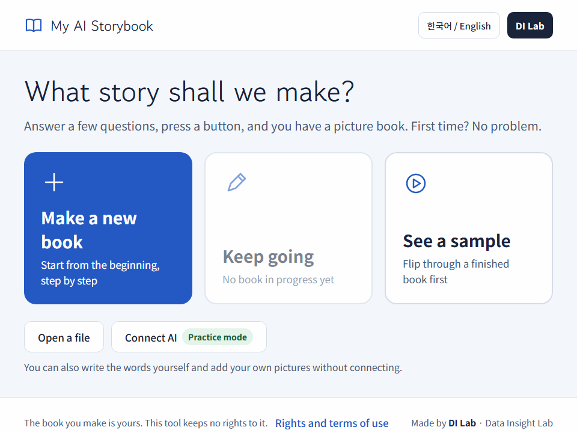
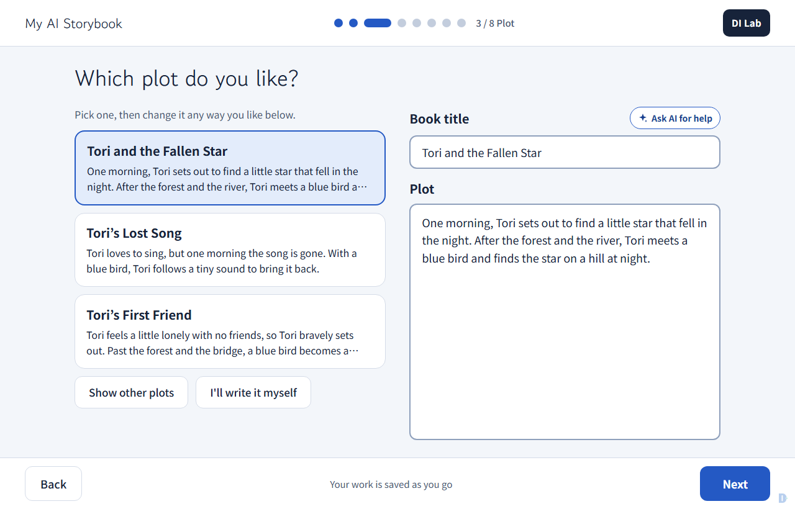
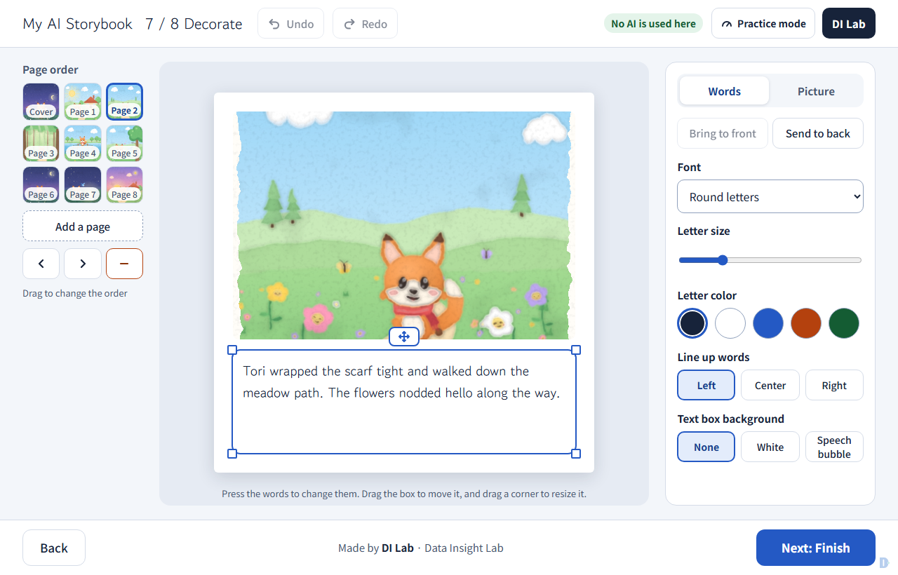
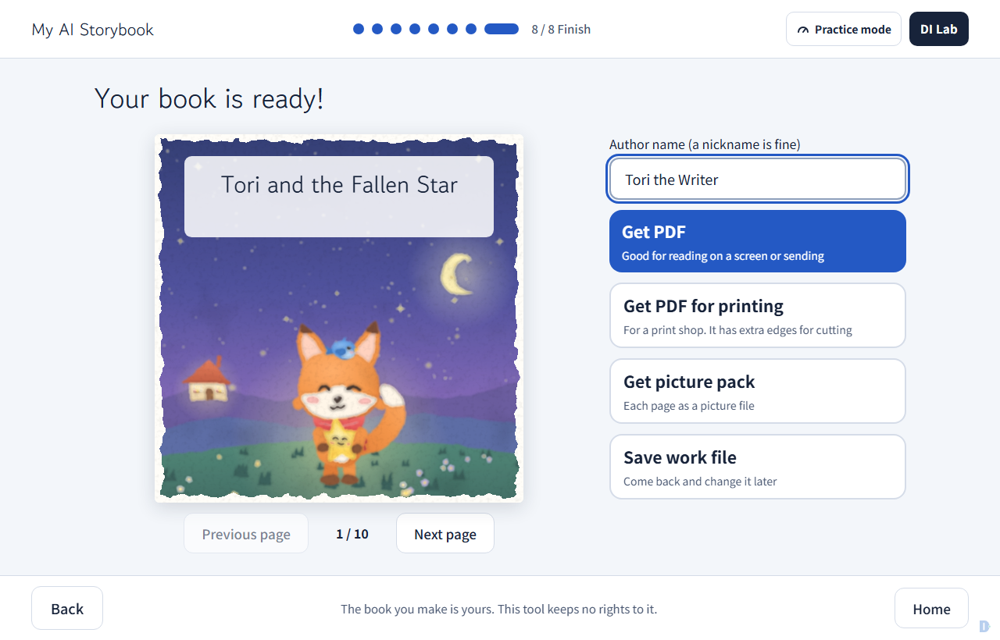
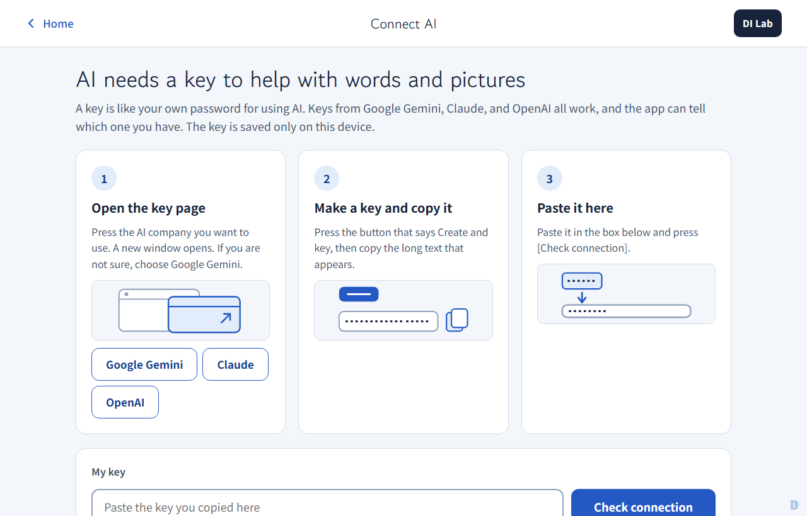
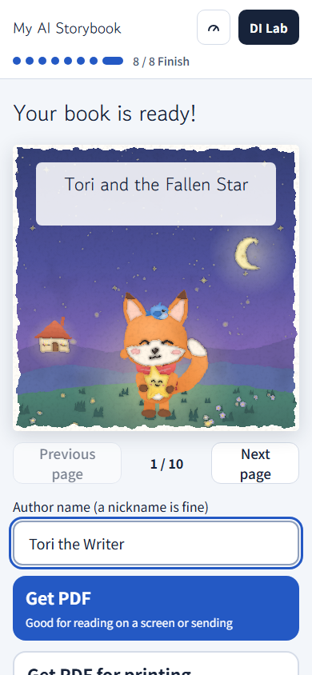

# My AI Storybook

A tool for making a short picture book in your browser. Nothing to install, no sign-up.

[](https://github.com/yhkim-data/my-ai-storybook/actions/workflows/deploy.yml)
[](https://github.com/yhkim-data/my-ai-storybook/actions/workflows/e2e.yml)
[](LICENSE)

[한국어](README.kr.md) | **English**



## Try it now

https://di-lab.io/my-ai-storybook/

Open the address in your browser and start. If this is your first time, press [See a sample] on the start screen to flip through a finished book first.

## What you can do

- **Pick a story.** Choose who will read it, a topic, and the main character's name and look, and AI suggests three plots. You can also write your own.
- **Split the words into pages.** Split the plot into 4, 6, or 8 pages, and change the words and picture notes right there.
- **Add pictures.** Let AI draw in one of six picture styles, or add your own drawing or photo.
- **Decorate.** Drag text boxes to move them, and change the size, font, color, and layout. You can undo.
- **Save.** Get a PDF for screens, a PDF for printing, a bundle of pictures, or a work file to keep editing later.
- **Finish without AI.** Without connecting AI, you can write the words and add pictures yourself and finish the whole book.

| Story seed | Pick a plot | Pictures |
|---|---|---|
|  |  |  |
| **Decorate** | **Finish** | **Connect AI** |
|  |  |  |

## Make it in 3 steps

1. **Pick the story.** Choose the reader, the topic, the main character's name and look, and the number of pages, then choose a plot.
2. **Add pictures.** Pick a picture style and add a picture to each page.
3. **Decorate and save.** Change the words and text boxes, then save as a PDF or a bundle of pictures.

The 8 steps are shown as dots at the top of the screen. You can go back to an earlier step at any time. Your work is saved as you go.

AI can draw the same character a little differently each time. A more detailed description of the character helps the pictures match, and if you do not like a picture, press [Remake only this picture] in the Decorate step.

## Connecting AI is optional

A book can be finished without any AI connection. To connect, enter a key from one of the companies below. The tool looks at the start of the key and works out which company it is from. If you are not sure, start with Google Gemini.

| Company | Writing | Pictures | Rough cost of one book | Key guide |
|---|---|---|---|---|
| Google Gemini | Yes | Yes | About 0.31 US dollars (with 9 pictures) | [How to get a key](docs/key-guide.en.md) |
| Claude | Yes | No | About 0.002 US dollars for the words (pictures extra) | [How to get a key](docs/key-guide.en.md) |
| OpenAI | Yes | Yes | Could not be worked out (the price of one picture is not in the documents) | [How to get a key](docs/key-guide.en.md) |

Price check date: 2026-11-14. Claude writes words only. With only a Claude key, add your own pictures, or enter a separate key for pictures (Gemini or OpenAI) in [More settings].

<details>
<summary>More about cost</summary>

Prices were checked in each company's official documents on 2026-11-14. The full record is in [PROVIDER_NOTES](docs/PROVIDER_NOTES.md), which is written in Korean. A token is the unit AI uses to count words. Prices are per 1 million tokens.

| Company | Writing (default AI type) | Pictures | Free limit |
|---|---|---|---|
| Google Gemini | `gemini-3.5-flash-lite`: input $0.30, output $2.50 | $0.0336 per picture | For writing only. None for pictures. |
| Claude | `claude-haiku-5-5`: input $0.10, output $0.50 (`claude-sonnet-5-5` $2 / $10, `claude-opus-5-5` $4 / $20) | Does not make pictures | None. You need a paid key. |
| OpenAI | `gpt-6-luna`: input $0.10, output $0.50 (`gpt-6.1-terra` $1 / $5, `gpt-6.1-sol` $2 / $10) | $30 per 1 million picture output tokens. The price per picture is not in the documents. | Not in the documents. |

This is the cost of one book with Google Gemini.

- 9 pictures (1 cover and 8 pages) x $0.0336 = $0.3024
- One book costs about 0.31 US dollars. This includes the cost of the writing.
- Making a picture again costs another $0.0336 each time.
- If AI writes the words and you add the pictures yourself, it costs nothing within the free limit.
- The Gemini AI that draws pictures has no free limit. You need a key with billing connected.
- For the number of free uses, check Google AI Studio.

Claude writes words only, so the words of one book cost about 0.002 US dollars. Pictures cost extra. They are free if you add your own. We could not work out the cost of one book with OpenAI, because the price of one picture is not in the documents.

Prices can change. Price check date: 2026-11-14

</details>

## Before you use it in class

Each company has its own age rule. (Checked 2026-11-14)

- Google Gemini: Only people 18 or older can get a key. Under the terms, it cannot be connected where people under 18 use it. On devices and in classes where students use the tool, the Gemini connection cannot be turned on.
- Claude: For people under 18 to use it, the adult or organization that got the key must have the safeguards Anthropic sets (an age check, content filtering, a way to watch and report problems, and more). The age of the person who gets a key: Anthropic's Commercial Terms of Service, which cover keys and the Console, have no age clause (checked 2026-11-14). The 18-or-older rule is in the Consumer Terms (effective 2025-10-08), which cover personal services such as Claude.ai.
- OpenAI: For people under 18 to use it, the organization that got the key must have the safeguards OpenAI sets and get consent from a parent or guardian.

This tool does not have an age check or a way to watch and report problems. In a class with students, using it without an AI connection is the basic way. A book can be finished without any AI connection. The original text and the details are in the [teacher guide](docs/teacher-guide.en.md).

Do not enter students' personal information such as real names, addresses, or phone numbers. Use a made-up name for the main character.

This is not legal advice.

## Your rights

만든 책의 권리는 만든 사람에게 있습니다. 이 도구와 DI Lab은 결과물에 어떤 권리도 주장하지 않습니다.

The rights to the book you make belong to you. This tool and DI Lab claim no rights to anything you create.

For fonts, the AI notice, and what to watch for when you use someone else's pictures, read [About your rights](docs/rights.en.md).

## Keys and privacy

- There is no server. The book you are making is saved in the browser on this device. We cannot see it.
- The key is saved only in the browser on this device. Only when you use AI, it is sent straight to the company the key belongs to (Google, Anthropic, or OpenAI). It is not sent anywhere else.
- Other people who use the same device may be able to see the key. On a shared device, press [Erase the key from this device] when you finish.
- To keep a book for a long time, save a work file with [Save work file].

## Works on phones and tablets



We test it at tablet and phone screen sizes. Moving and resizing text boxes is easier on a bigger screen.

## How it was built

Claude Code built this tool from one instruction file. The instruction file, the screen mockups, the helper-agent definitions, and what a person did and what Claude Code did are in [How it was built](docs/how-it-was-built/README.en.md).

## For developers

You need Node 20 or newer.

```
npm install
npm run dev
```

The check commands are `npm run lint`, `npm run typecheck`, `npm run test`, `npm run e2e`, `npm run build`, `npm run check:secrets`, `npm run check:i18n`, and `npm run check:links`. See the [development guide](docs/DEVELOPMENT.ko.md) (Korean) for more.

The check that uses real keys (`e2e/real-api.spec.ts`) runs only when `GEMINI_API_KEY`, `ANTHROPIC_API_KEY`, or `OPENAI_API_KEY` is set.

To practice the AI steps without a key, add `?mock=1` to the end of the address. You get ready-made sample stories and pictures.

If you want to fix something, read [Contributing](CONTRIBUTING.md) and open an issue or a pull request.

Documents:

- [How to get a key](docs/key-guide.en.md) ([Korean](docs/key-guide.ko.md))
- [Teacher guide](docs/teacher-guide.en.md) ([Korean](docs/teacher-guide.ko.md))
- [About your rights](docs/rights.en.md) ([Korean](docs/rights.ko.md))
- [Record of AI provider terms](docs/PROVIDER_NOTES.md) (Korean)
- [Development guide](docs/DEVELOPMENT.ko.md) (Korean)
- [Release notes v1.0.0](docs/releases/v1.0.0.md)

## License

The code is under the MIT License. See [LICENSE](LICENSE). The three fonts used in books are under the SIL Open Font License (OFL) 1.1. Licenses of the fonts and libraries are in [THIRD_PARTY_NOTICES.md](THIRD_PARTY_NOTICES.md) (Korean).

Repository: https://github.com/yhkim-data/my-ai-storybook

---

Made by DI Lab · Data Insight Lab
