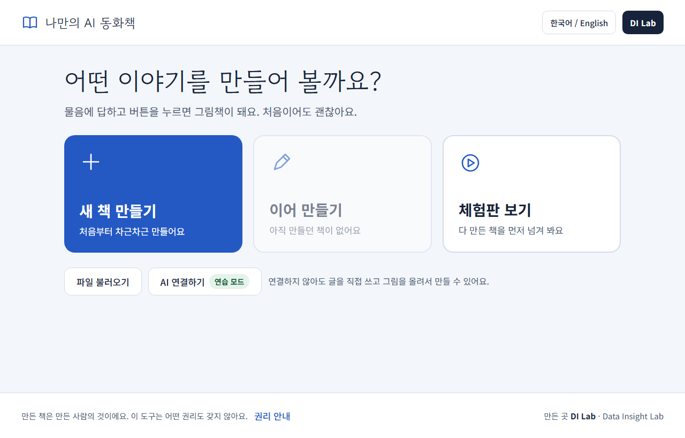
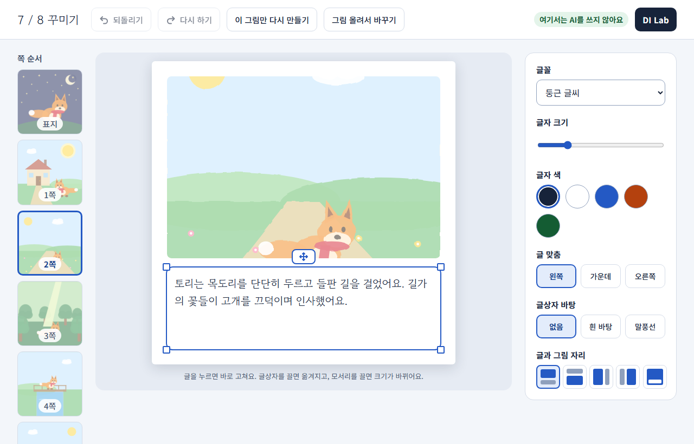
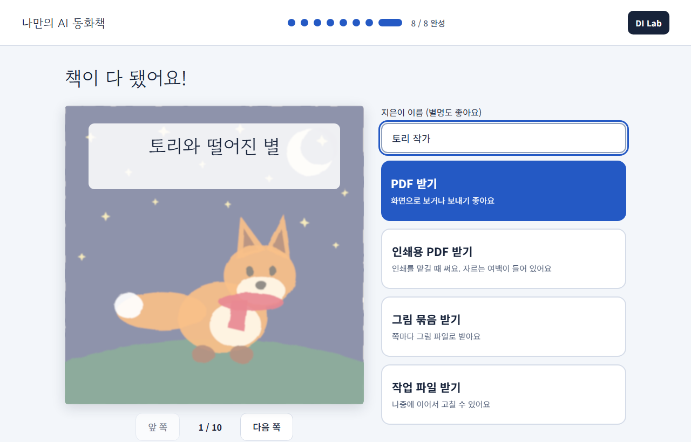
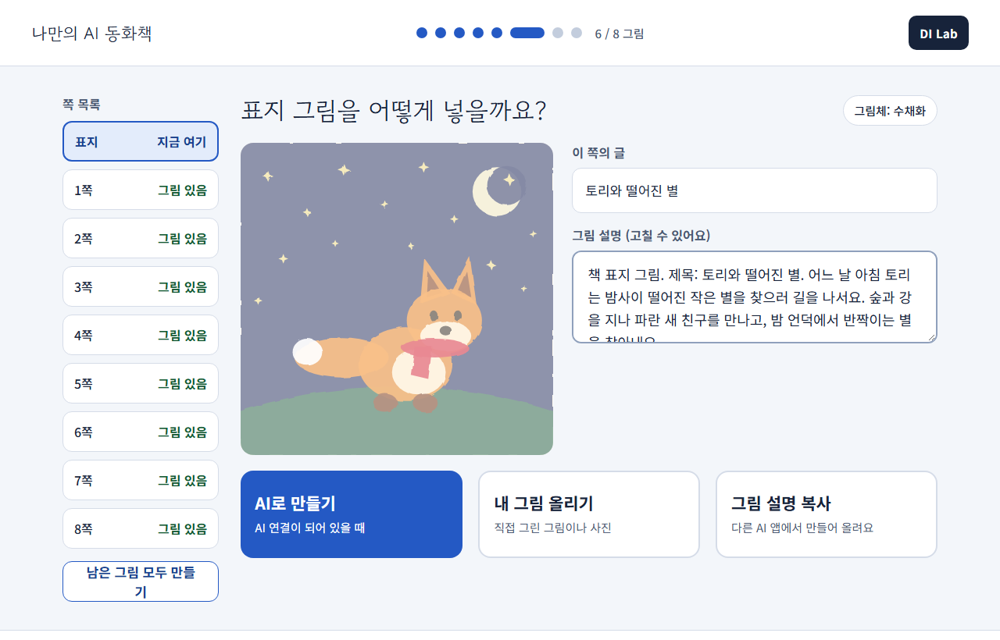
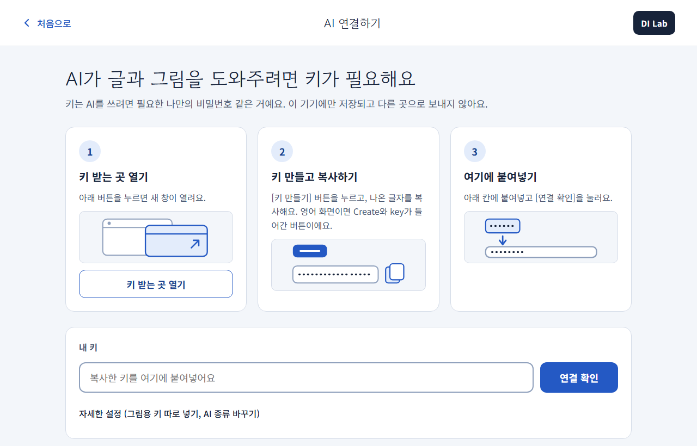

# My AI Storybook

**English** | [한국어](README.md)

A tool for making a short picture book in your web browser. No install and no sign-up.

| Start | Decorate | Finish |
|---|---|---|
|  |  |  |

## Try it now

https://di-lab.io/my-ai-storybook/

If this is your first time, press [See a sample] on the start screen to flip through a finished book.

## Make a book in 3 steps

1. **Choose your story.** Pick who will read it, the topic, the main character's name and look, and the number of pages. Then choose a plot.
2. **Add pictures.** Pick a picture style, then add a picture for each page.
3. **Decorate and save.** Fix the words and text boxes, then save a PDF or a picture pack.

Eight steps show as dots at the top of the screen. You can go back to an earlier step at any time. Your work saves automatically.



## What works without a key

You can finish a book without connecting any AI.

- **Write it yourself.** You write the plot and the words for each page.
- **Add my picture.** Add a drawing or a photo of your own.
- **Copy picture note.** Copy the picture note for a page, paste it into another AI app, and add the picture you get.
- **See a sample.** Flip through a finished book.

If you want to connect AI, read [how to get a key](docs/key-guide.en.md).



## Your rights

만든 책의 권리는 만든 사람에게 있습니다. 이 도구와 DI Lab은 결과물에 어떤 권리도 주장하지 않습니다.

The rights to the book you make belong to you. This tool and DI Lab claim no rights to anything you create.

For fonts, the AI notice, and what to watch for when you use someone else's pictures, read [About your rights](docs/rights.en.md).

## Cost

Prices were checked in Google's official documents on 2026-11-14. The full record is in [PROVIDER_NOTES](docs/PROVIDER_NOTES.md), which is written in Korean.

- 9 pictures (1 cover and 8 pages) x $0.0336 = $0.3024
- One book costs about 0.31 US dollars. This includes the cost of the writing.
- Making a picture again costs another $0.0336 each time.
- If AI writes the words and you add the pictures yourself, it costs nothing within the free limit.
- The AI that draws pictures has no free limit. You need a key with billing connected.
- For the number of free uses, check Google AI Studio.

Prices can change. Price check date: 2026-11-14

## Age requirement

Under Google's terms, only people 18 or older can get a key.

The terms also do not allow connecting the AI to a service that people under 18 are likely to use. So for classes with students, we recommend using the tool without connecting AI. The school must read the terms and decide whether to turn AI on. See the [teacher guide](docs/teacher-guide.en.md) for details.

## Frequently asked questions

**Do I need to install anything?**
No. Open the address in your browser and start.

**Does it cost money?**
Without AI, it costs nothing. If AI writes only the words, it costs nothing within the free limit. Money is needed only when AI makes the pictures. See Cost above.

**Where are my words and pictures saved?**
The book you are making is saved in the browser on this device. There is no server, so we cannot see it. Only when you use AI, your browser sends a request straight to Google. To keep a book for a long time, save a work file with [Save work file].

**Is my key safe?**
The key is saved only in the browser on this device and is not sent anywhere else. Still, other people who use the same device may be able to see it. On a shared device, press [Erase the key from this device] when you finish.

**Can I sell or print the book I made?**
This tool and DI Lab claim no rights. You may also print, share, and sell books that use the three fonts. But the law on AI-made pictures differs from country to country. If you add someone else's picture or character, you need that person's permission. See [About your rights](docs/rights.en.md).

**The main character looks different on each page.**
AI can draw the same character a little differently each time. This tool puts the written description of the character in front of every picture note. If you do not like a picture, press [Remake only this picture] in the Decorate step. A more detailed description of the character helps the pictures match.

**Does it work on a phone?**
Yes. We test it at tablet and phone screen sizes. Moving and resizing text boxes is easier on a bigger screen.

## Documents

- [How to get a key](docs/key-guide.en.md) ([Korean](docs/key-guide.ko.md))
- [Teacher guide](docs/teacher-guide.en.md) ([Korean](docs/teacher-guide.ko.md))
- [About your rights](docs/rights.en.md) ([Korean](docs/rights.ko.md))
- [Record of AI provider terms](docs/PROVIDER_NOTES.md) (Korean)
- [Development guide](docs/DEVELOPMENT.ko.md) (Korean)
- [Contributing](CONTRIBUTING.md)
- [Third-party notices](THIRD_PARTY_NOTICES.md) (Korean)

## For developers

You need Node 20 or newer.

```
npm install
npm run dev
```

The check commands are `npm run lint`, `npm run typecheck`, `npm run test`, `npm run e2e`, `npm run build`, `npm run check:secrets`, and `npm run check:i18n`. See the [development guide](docs/DEVELOPMENT.ko.md) for more.

To practice the AI steps without a key, add `?mock=1` to the end of the address. You get ready-made sample stories and pictures.

## License

MIT License. See [LICENSE](LICENSE). Licenses of the fonts and libraries are in [THIRD_PARTY_NOTICES.md](THIRD_PARTY_NOTICES.md).

Repository: https://github.com/yhkim-data/my-ai-storybook

---

Made by DI Lab · Data Insight Lab
