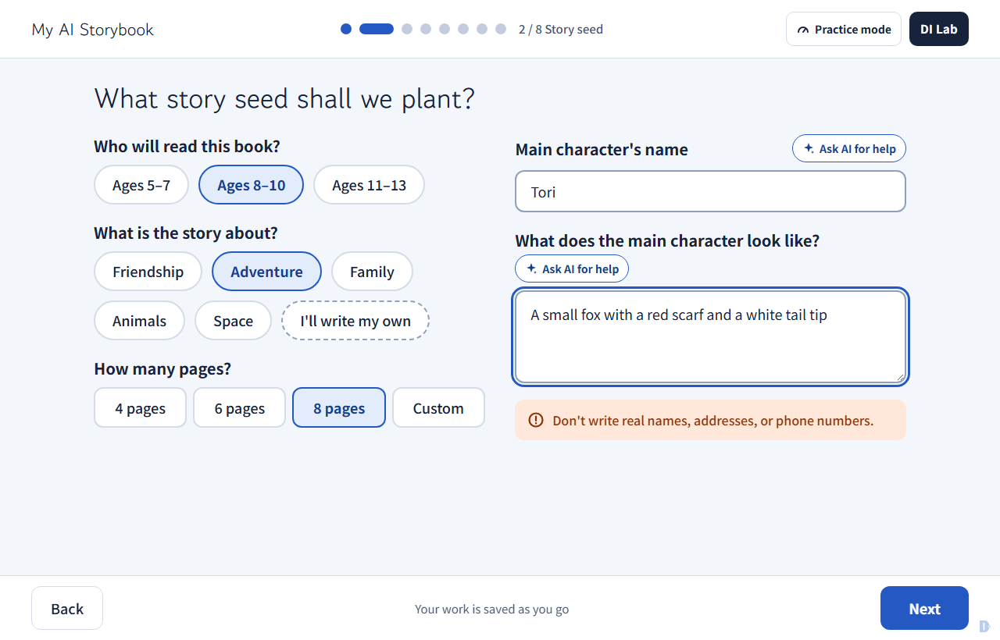
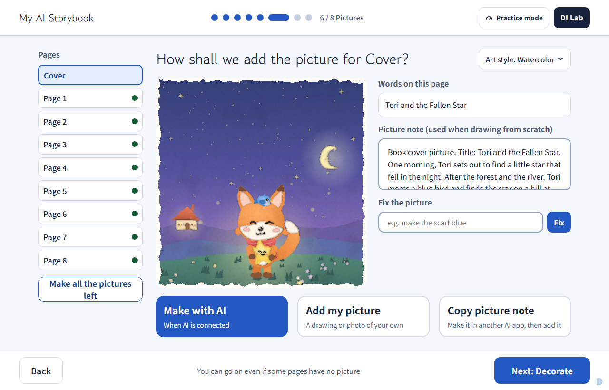

# My AI Storybook

A browser-based tool for making short picture books. No installation or sign-up required.

[](https://github.com/yhkim-data/my-ai-storybook/actions/workflows/deploy.yml)
[](https://github.com/yhkim-data/my-ai-storybook/actions/workflows/e2e.yml)
[](LICENSE)

[한국어](README.kr.md) | **English**


## Try it now

https://di-lab.io/my-ai-storybook/

Open the address in your browser to start. If this is your first visit, press [See a sample] on the start screen to flip through a finished book.

## Features

- **Story setup:** Choose the reader, a topic, and the main character's name and look, and AI suggests three plots. You can also write your own.
- **Page text:** Split the plot into 4, 6, or 8 pages, and edit the text and picture notes for each page in place.
- **Images:** Let AI draw in one of six art styles, or upload your own drawings or photos.
- **Layout:** Drag text boxes and change their size, font, color, and placement. Undo is supported.
- **Export:** Save a PDF for screens, a PDF for printing, an image bundle, or a work file for further editing.
- **Works without AI:** Without any AI connection, you can write the text, upload images, and finish the whole book.

| Story seed | Pick a plot | Pictures |
|---|---|---|
|  |  |  |
| **Decorate** | **Finish** | **Connect AI** |
|  |  |  |

## How it works

1. **Set up the story.** Choose the reader, topic, main character's name and look, and number of pages, then choose a plot.
2. **Add images.** Pick an art style and add an image to each page.
3. **Lay out and export.** Refine the text and text boxes, then save as a PDF or an image bundle.

All 8 steps are shown as dots at the top of the screen, and you can return to an earlier step at any time. Your work is saved automatically.

AI may draw the same character slightly differently from image to image. A more detailed character description improves consistency, and you can regenerate any image with [Remake only this picture] in the Decorate step.

## AI connection (optional)

You can finish a book without connecting AI. To use AI, enter a key from one of the providers below. The app reads the start of the key and detects which provider it belongs to.

| Provider | Text | Images | Approx. cost per book | Key guide |
|---|---|---|---|---|
| No AI connection | Written by you | Uploaded by you | Free | Not needed |
| Google Gemini (free tier) | Yes | No | Free (within Google's usage limits) | [How to get a key](docs/key-guide.en.md) |
| Google Gemini (billing enabled) | Yes | Yes | About US$0.31 (incl. 9 images) | [How to get a key](docs/key-guide.en.md) |
| Claude | Yes | No | About US$0.002 for text (images separate) | [How to get a key](docs/key-guide.en.md) |
| OpenAI | Yes | Yes | Not available (per-image price not published) | [How to get a key](docs/key-guide.en.md) |

- The free tier applies to Google AI Studio keys without billing. Google sets the usage limits.
- On the free tier, the content you enter and the AI's responses may be used to improve Google's products and may be read by human reviewers ([PROVIDER_NOTES](docs/PROVIDER_NOTES.md) section 2, the Unpaid Services data-use clause of the Gemini API terms).
- Gemini cannot be used in classes with students ([Using it in class](#using-it-in-class)).
- Without a key, the AI features do not work. No key or money from the tool's operator is ever used.

For personal use, the simplest way to start is to try writing with the Gemini free tier. Before using the tool with students, read [Using it in class](#using-it-in-class).

Prices checked on 2026-11-14. Claude writes text only. With only a Claude key, upload your own images, or enter a separate image key (Gemini or OpenAI) in [More settings].

<details>
<summary>Cost details</summary>

Prices were checked in each provider's official documentation on 2026-11-14. The full record is in [PROVIDER_NOTES](docs/PROVIDER_NOTES.md) (Korean). A token is the unit AI uses to measure text; prices are per 1 million tokens.

| Provider | Text (default AI) | Images | Free tier |
|---|---|---|---|
| Google Gemini | `gemini-3.5-flash-lite`: input $0.30, output $2.50 | $0.0336 per image | Text only. None for images. |
| Claude | `claude-haiku-5-5`: input $0.10, output $0.50 (`claude-sonnet-5-5` $2 / $10, `claude-opus-5-5` $4 / $20) | Not supported | None. A key with billing is required. |
| OpenAI | `gpt-6-luna`: input $0.10, output $0.50 (`gpt-6.1-terra` $1 / $5, `gpt-6.1-sol` $2 / $10) | $30 per 1 million image output tokens. Per-image price not published. | Not stated in the documentation |

Cost of one book with Google Gemini:

- 9 images (1 cover and 8 pages) x $0.0336 = $0.3024
- About US$0.31 per book, including text.
- Each regenerated image costs another $0.0336.
- If AI writes the text and you upload the images, it is free within the free tier.
- The Gemini image AI has no free tier, so a key with billing is required.
- Check Google AI Studio for the free-tier usage limits.

Claude writes text only; the text for one book costs about US$0.002. Images cost extra, or nothing if you upload your own. The cost of a book with OpenAI could not be calculated because the per-image price is not published.

Prices may change. Price check date: 2026-11-14

</details>

## Using it in class

Each provider has its own age rule. (Checked 2026-11-14)

- **Google Gemini:** Only people 18 or older can get a key. The terms prohibit connecting it to a service used by people under 18, so Gemini cannot be connected on devices or in classes where students use the tool.
- **Claude:** For people under 18 to use it, the adult or organization that holds the key must provide the safeguards Anthropic requires (age checks, content filtering, monitoring and reporting, and more). Anthropic's Commercial Terms of Service, which cover API keys and the Console, have no age clause for the key holder (checked 2026-11-14). The 18-or-older rule is in the Consumer Terms (effective 2025-10-08), which cover personal services such as Claude.ai.
- **OpenAI:** For people under 18 to use it, the organization that holds the key must have the safeguards OpenAI requires and obtain consent from a parent or guardian.

This tool has no age check and no monitoring or reporting system. In classes with students, the default is to use it without an AI connection; a book can still be finished. The original wording and details are in the [teacher guide](docs/teacher-guide.en.md).

Do not enter students' personal information such as real names, addresses, or phone numbers. Use a made-up name for the main character.

This is not legal advice.

## Rights and terms of use

만든 책의 권리는 만든 사람에게 있습니다. 이 도구와 DI Lab은 결과물에 어떤 권리도 주장하지 않습니다.

The rights to the book you make belong to you. This tool and DI Lab claim no rights to anything you create.

- Korean copyright law protects only works made by people. AI-made parts themselves may not be protected, while parts a person edited, selected, or arranged can be.
- Google, Anthropic, and OpenAI state in their terms that they do not claim, or that they assign to you, the rights in AI output. This is separate from whether the law protects the output as a work.
- All fonts used in books are under the SIL Open Font License, so books can be printed, shared, and sold. If a book has AI images, an AI notice is added to it automatically.
- Schools and organizations need permission from students and parents, and consent for personal information, to publish student work (legal-representative consent for children under 14 in Korea).

Legal sources, original terms, and check dates are in the full [Rights and terms of use](docs/rights.en.md) guide.

## Privacy and API keys

- There is no server. Your book is stored only in this device's browser, and the operator cannot see it.
- The key is stored only in this device's browser and is sent directly to the provider that issued it (Google, Anthropic, or OpenAI) only when AI is used. It is never sent anywhere else.
- Other people using the same device may be able to see the key. On a shared device, press [Erase the key from this device] when you finish.
- To keep a book long term, save a work file with [Save work file].

## Supported devices


The app is tested at tablet and phone screen sizes. Moving and resizing text boxes is easier on a larger screen. Automated tests run in Chromium-based browsers.

## Development

Requires Node 20 or later.

```
npm install
npm run dev
```

Checks: `npm run lint`, `npm run typecheck`, `npm run test`, `npm run e2e`, `npm run build`, `npm run check:secrets`, `npm run check:i18n`, and `npm run check:links`. See the [development guide](docs/DEVELOPMENT.ko.md) (Korean) for details.

The test that calls the real APIs (`e2e/real-api.spec.ts`) runs only when `GEMINI_API_KEY`, `ANTHROPIC_API_KEY`, or `OPENAI_API_KEY` is set.

To try the AI steps without a key, add `?mock=1` to the end of the address. Sample stories and images are provided.

To suggest improvements, read [Contributing](CONTRIBUTING.md) and open an issue or a pull request.

Documents:

- [How to get a key](docs/key-guide.en.md) ([Korean](docs/key-guide.ko.md))
- [Teacher guide](docs/teacher-guide.en.md) ([Korean](docs/teacher-guide.ko.md))
- [Rights and terms of use](docs/rights.en.md) ([Korean](docs/rights.ko.md))
- [Record of AI provider terms](docs/PROVIDER_NOTES.md) (Korean)
- [Development guide](docs/DEVELOPMENT.ko.md) (Korean)
- [Release notes v1.0.0](docs/releases/v1.0.0.md)

## License

The code is released under the MIT License. See [LICENSE](LICENSE). The three fonts used in books are under the SIL Open Font License (OFL) 1.1. Licenses for fonts and libraries are in [THIRD_PARTY_NOTICES.md](THIRD_PARTY_NOTICES.md) (Korean).

Repository: https://github.com/yhkim-data/my-ai-storybook

---

DI Lab · Data Insight Lab
