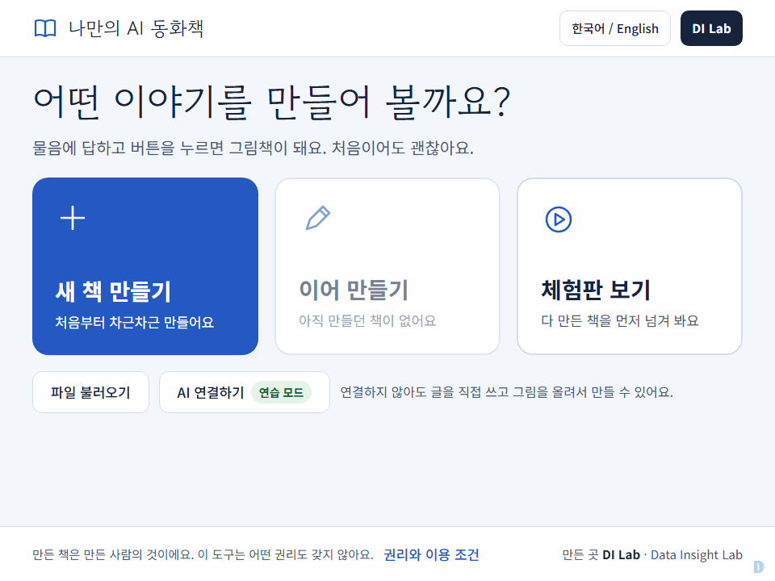
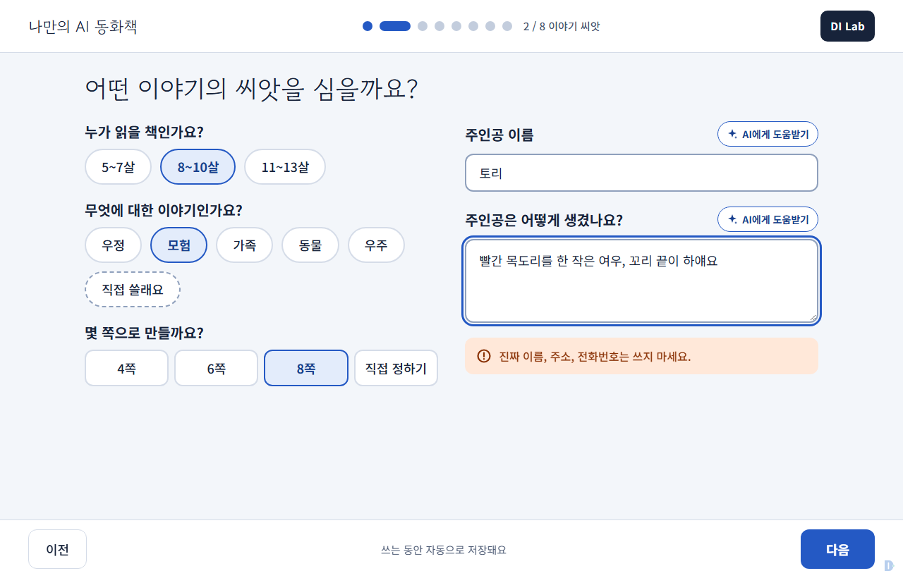
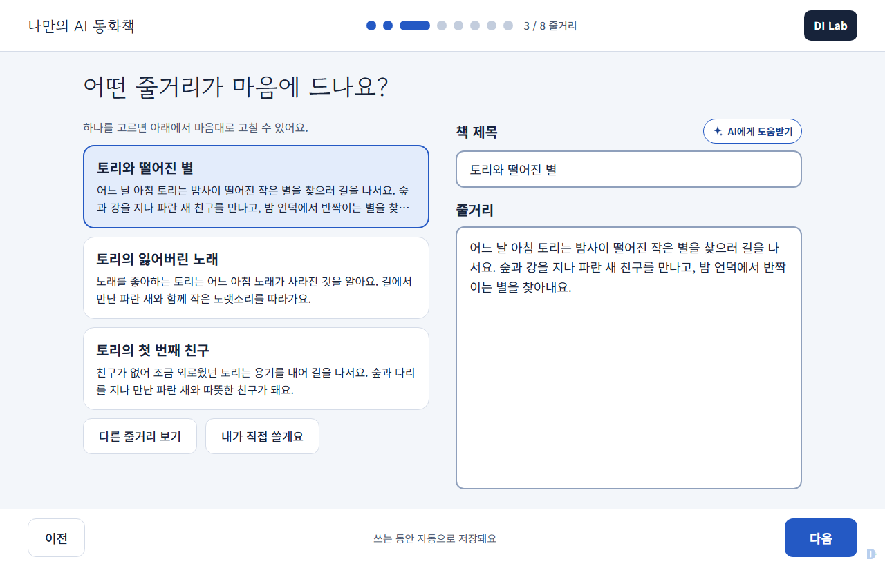
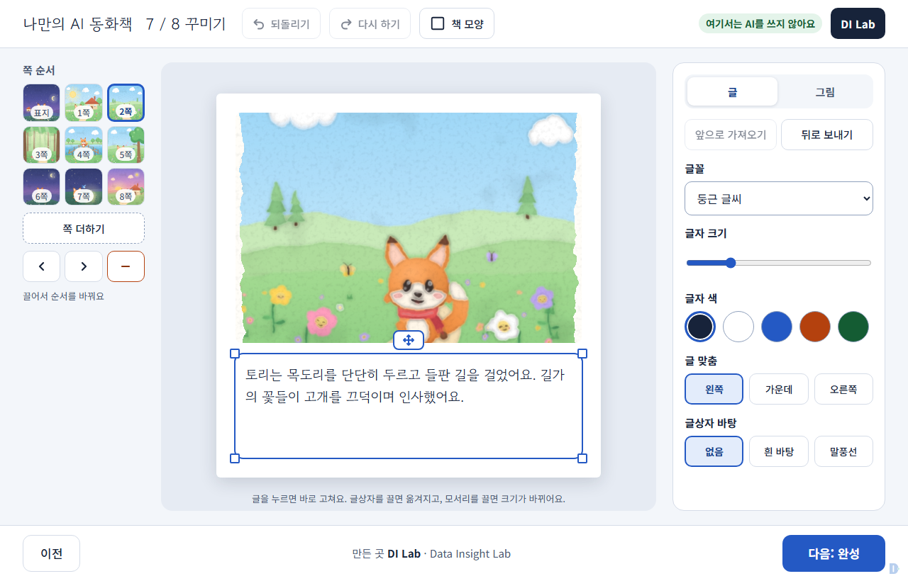

# 나만의 AI 동화책

브라우저만 열면 짧은 그림책을 만들 수 있는 도구예요. 설치도, 회원가입도 없어요.

[](https://github.com/yhkim-data/my-ai-storybook/actions/workflows/deploy.yml)
[](https://github.com/yhkim-data/my-ai-storybook/actions/workflows/e2e.yml)
[](LICENSE)

**한국어** | [English](README.en.md)



## 바로 써보기

https://di-lab.io/my-ai-storybook/

브라우저에서 주소를 열면 바로 써요. 처음이라면 시작 화면에서 [체험판 보기]를 눌러 다 만든 책을 먼저 넘겨 보세요.

## 할 수 있는 것

- **이야기 정하기.** 읽을 사람, 주제, 주인공 이름과 모습을 고르면 AI가 줄거리 세 개를 제안해요. 직접 써도 돼요.
- **쪽마다 글 나누기.** 줄거리를 4, 6, 8쪽으로 나누고, 글과 그림 설명을 바로 고쳐요.
- **그림 넣기.** 그림체 여섯 가지 중 하나로 AI가 그리거나, 직접 그린 그림이나 사진을 올려요.
- **꾸미기.** 글상자를 끌어 옮기고 크기, 글꼴, 색, 배치를 바꿔요. 되돌리기도 돼요.
- **받기.** 화면용 PDF, 인쇄용 PDF, 그림 묶음, 나중에 이어 고칠 작업 파일로 받아요.
- **AI 없이도 끝까지.** AI를 연결하지 않아도 글을 직접 쓰고 그림을 올려서 책을 끝까지 만들 수 있어요.

| 이야기 씨앗 | 줄거리 고르기 | 그림 |
|---|---|---|
|  |  |  |
| **꾸미기** | **완성** | **AI 연결하기** |
|  |  |  |

## 3단계로 만들어요

1. **이야기를 정해요.** 읽을 사람, 주제, 주인공 이름과 모습, 쪽수를 고르고 줄거리를 정해요.
2. **그림을 넣어요.** 그림체를 고르고, 쪽마다 그림을 넣어요.
3. **꾸미고 받아요.** 글과 글상자를 고치고, PDF나 그림 묶음으로 받아요.

화면 위쪽에 8단계가 점으로 보여요. 언제든 앞 단계로 돌아갈 수 있어요. 만드는 동안 자동으로 저장돼요.

AI는 같은 주인공도 조금씩 다르게 그려요. 주인공 모습을 자세히 쓰면 더 비슷해지고, 마음에 안 드는 그림은 꾸미기 단계에서 [이 그림만 다시 만들기]로 다시 만들 수 있어요.

## AI 연결은 선택이에요

AI를 연결하지 않아도 책을 끝까지 만들 수 있어요. 연결하려면 아래 회사 중 하나의 키를 넣어요. 키 앞머리를 보고 어느 회사 키인지 알아서 알아봐요. 잘 모르겠으면 Google Gemini로 시작하세요.

| 회사 | 글 | 그림 | 책 한 권 대략 비용 | 키 안내 |
|---|---|---|---|---|
| Google Gemini | 돼요 | 돼요 | 약 0.31달러 (그림 9장 포함) | [키 받는 법](docs/key-guide.ko.md) |
| Claude | 돼요 | 안 돼요 | 글 약 0.002달러 (그림은 따로) | [키 받는 법](docs/key-guide.ko.md) |
| OpenAI | 돼요 | 돼요 | 계산하지 못했어요 (그림 한 장 값이 문서에 없어요) | [키 받는 법](docs/key-guide.ko.md) |

가격 확인일: 2026-11-14. Claude는 글만 만들어요. Claude 키만 있으면 그림은 직접 올리거나, [자세한 설정]에서 그림용 키(Gemini나 OpenAI)를 따로 넣어요.

<details>
<summary>비용 자세히 보기</summary>

가격은 2026-11-14에 각 회사의 공식 문서에서 확인했어요. 자세한 기록은 [PROVIDER_NOTES](docs/PROVIDER_NOTES.md)에 있어요. 토큰은 AI가 글을 세는 단위예요. 가격은 100만 토큰당이에요.

| 회사 | 글 (기본 AI 종류) | 그림 | 무료 한도 |
|---|---|---|---|
| Google Gemini | `gemini-3.5-flash-lite`: 입력 $0.30, 출력 $2.50 | 한 장 $0.0336 | 글에만 있어요. 그림에는 없어요. |
| Claude | `claude-haiku-5-5`: 입력 $0.10, 출력 $0.50 (`claude-sonnet-5-5` $2 / $10, `claude-opus-5-5` $4 / $20) | 만들지 않아요 | 없어요. 돈을 내는 키가 필요해요. |
| OpenAI | `gpt-6-luna`: 입력 $0.10, 출력 $0.50 (`gpt-6.1-terra` $1 / $5, `gpt-6.1-sol` $2 / $10) | 그림 출력 100만 토큰당 $30. 한 장 값은 문서에 없어요. | 문서에 없어요. |

Google Gemini로 만들 때의 책 한 권 비용이에요.

- 그림 9장(표지 1장 + 본문 8장) x $0.0336 = $0.3024
- 책 한 권에 약 0.31달러예요. 글을 쓰는 비용을 더한 값이에요.
- 그림을 다시 만들면 한 장에 $0.0336씩 더 들어요.
- 글만 AI로 쓰고 그림은 직접 올리면, 무료 한도 안에서 0원이에요.
- 그림을 만드는 Gemini AI에는 무료 한도가 없어요. 결제를 연결한 키가 있어야 해요.
- 무료 한도의 횟수는 Google AI Studio에서 확인하세요.

Claude는 글만 만들어서 책 한 권의 글 값이 약 0.002달러예요. 그림 값은 따로 들어요. 직접 올리면 0원이에요. OpenAI는 그림 한 장 값이 문서에 없어서 책 한 권의 값을 계산하지 못했어요.

가격은 바뀔 수 있어요. 가격 확인일: 2026-11-14

</details>

## 수업에서 쓰기 전에

회사마다 나이 조건이 달라요. (2026-11-14에 확인)

- Google Gemini: 키는 만 18세 이상만 받을 수 있어요. 약관에 따라 18세 미만이 쓰는 곳에는 연결할 수 없어요. 학생이 쓰는 기기와 수업에서는 Gemini 연결을 켜 둘 수 없어요.
- Claude: 18세 미만이 쓰게 하려면 키를 받은 어른이나 기관이 Anthropic이 정한 보호 조치(나이 확인, 내용 거르기, 지켜보고 신고하는 장치 등)를 갖춰야 해요. 키를 받는 사람의 나이: 키와 콘솔에 적용되는 Anthropic 상업 서비스 약관(Commercial Terms of Service)에는 나이 조항이 없어요(2026-11-14 확인). 18세 이상 조건은 Claude.ai 같은 개인용 서비스 약관(Consumer Terms, 2025-10-08 시행)에 있어요.
- OpenAI: 18세 미만에게 쓰게 하려면 키를 받은 조직이 OpenAI가 정한 보호 조치를 갖추고, 보호자 동의를 받아야 해요.

이 도구는 나이 확인 장치와 지켜보고 신고하는 장치를 갖추지 못했어요. 학생이 쓰는 수업에서는 AI 연결 없이 쓰는 것이 기본이에요. AI 연결 없이도 책을 끝까지 만들 수 있어요. 원문과 자세한 조건은 [선생님 안내서](docs/teacher-guide.ko.md)에 있어요.

학생의 진짜 이름, 주소, 전화번호 같은 개인정보는 넣지 마세요. 주인공 이름은 지어낸 이름을 써요.

이 안내는 법률 자문이 아니에요.

## 권리 안내

만든 책의 권리는 만든 사람에게 있습니다. 이 도구와 DI Lab은 결과물에 어떤 권리도 주장하지 않습니다.

The rights to the book you make belong to you. This tool and DI Lab claim no rights to anything you create.

글꼴, AI 그림 표시, 다른 사람의 그림을 쓸 때 주의할 점은 [권리 안내](docs/rights.ko.md)에 있어요.

## 키와 개인정보

- 서버가 없어요. 만들던 책은 이 기기의 브라우저 안에 저장돼요. 우리가 볼 수 없어요.
- 키는 이 기기의 브라우저에만 저장되고, AI를 쓸 때만 그 키를 넣은 회사(Google, Anthropic, OpenAI)로 바로 보내요. 다른 곳으로는 보내지 않아요.
- 같은 기기를 쓰는 사람은 키를 볼 수 있어요. 함께 쓰는 기기에서는 끝나고 [이 기기에서 키 지우기]를 눌러요.
- 오래 두고 싶다면 [작업 파일 받기]로 파일을 받아 두세요.

## 휴대폰과 태블릿에서도 돼요


태블릿과 휴대폰 화면 크기에서 쓸 수 있게 검사하고 있어요. 글상자를 옮기고 크기를 바꾸는 일은 큰 화면이 더 편해요.

## 만든 과정

이 도구는 Claude Code가 지시서 한 장으로 만들었어요. 지시서, 화면 시안, 보조 작업자 정의와 사람이 한 일, Claude Code가 한 일은 [만든 과정](docs/how-it-was-built/README.md)에 있어요.

## 개발자용

Node 20 이상이 필요해요.

```
npm install
npm run dev
```

검사 명령은 `npm run lint`, `npm run typecheck`, `npm run test`, `npm run e2e`, `npm run build`, `npm run check:secrets`, `npm run check:i18n`, `npm run check:links`예요. 자세한 내용은 [개발 문서](docs/DEVELOPMENT.ko.md)를 보세요.

실제 키로 확인하는 검사(`e2e/real-api.spec.ts`)는 `GEMINI_API_KEY`, `ANTHROPIC_API_KEY`, `OPENAI_API_KEY`가 있을 때만 돌아요.

키 없이 AI 단계를 연습하려면 주소 끝에 `?mock=1`을 붙여요. 미리 준비된 예시 이야기와 그림이 나와요.

고치고 싶은 것이 있으면 [기여 안내](CONTRIBUTING.md)를 읽고 이슈나 PR을 올려 주세요.

문서 목록:

- [키 받는 법](docs/key-guide.ko.md) ([English](docs/key-guide.en.md))
- [선생님 안내서](docs/teacher-guide.ko.md) ([English](docs/teacher-guide.en.md))
- [권리 안내](docs/rights.ko.md) ([English](docs/rights.en.md))
- [AI 제공사 조건 확인 기록](docs/PROVIDER_NOTES.md)
- [개발 문서](docs/DEVELOPMENT.ko.md)
- [릴리스 노트 v1.0.0](docs/releases/v1.0.0.md)

## 라이선스

코드는 MIT 라이선스예요. [LICENSE](LICENSE)를 보세요. 책에 쓰는 글꼴 세 가지는 SIL Open Font License(OFL) 1.1이에요. 글꼴과 라이브러리의 라이선스는 [THIRD_PARTY_NOTICES.md](THIRD_PARTY_NOTICES.md)에 있어요.

저장소: https://github.com/yhkim-data/my-ai-storybook

---

만든 곳 DI Lab · Data Insight Lab
