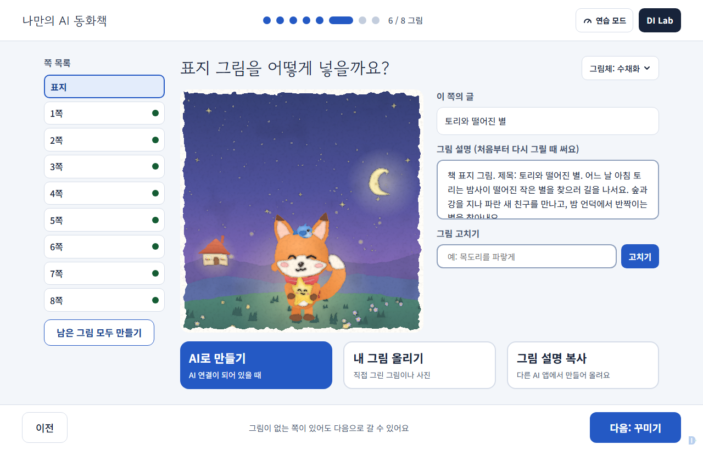
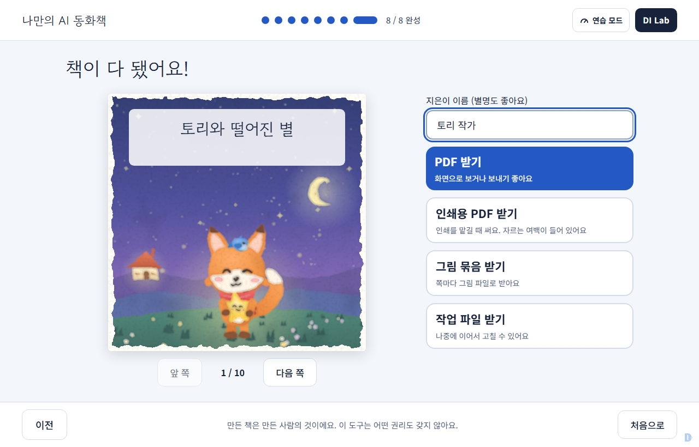
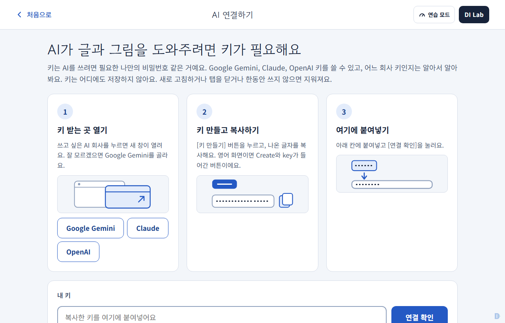
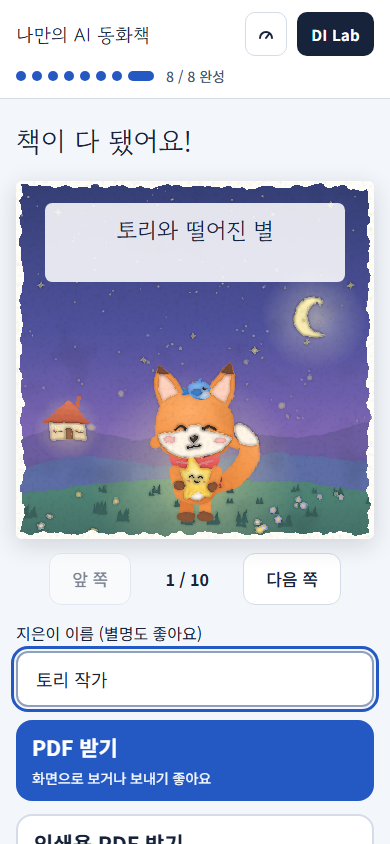

# 나만의 AI 동화책

브라우저에서 짧은 그림책을 만드는 도구입니다. 설치와 회원가입이 필요하지 않습니다.

[](https://github.com/yhkim-data/my-ai-storybook/actions/workflows/deploy.yml)
[](https://github.com/yhkim-data/my-ai-storybook/actions/workflows/e2e.yml)
[](LICENSE)

**한국어** | [English](README.en.md)


## 바로 써보기

https://storybook.di-lab.io/

브라우저에서 주소를 열면 바로 사용할 수 있습니다. 처음이라면 시작 화면의 [체험판 보기]로 완성된 책을 먼저 넘겨 보십시오.

## 주요 기능

- **이야기 설정:** 읽을 사람, 주제, 주인공의 이름과 모습을 고르면 AI가 줄거리 세 가지를 제안합니다. 직접 쓸 수도 있습니다.
- **쪽 나누기:** 줄거리를 2~20쪽으로 나눕니다(4, 6, 8쪽은 바로 고르고, 그 밖의 쪽 수는 [직접 정하기]로 정합니다). 쪽 목록에서 쪽을 골라 글과 그림 설명을 바로 고칠 수 있습니다.
- **AI 글쓰기 도움:** 주인공 이름과 모습, 이야기 한 줄, 제목과 줄거리, 쪽마다의 글과 그림 설명 칸에서 [AI에게 도움받기]를 누르면 빈 칸에는 초안을, 이미 쓴 칸에는 쓴 내용을 살려 다듬은 글을 받습니다. [되돌리기]로 원래 글로 돌아갈 수 있으며, AI 연결이 필요합니다.
- **그림 넣기:** 그림체 여섯 가지 중 하나로 AI가 그리거나, 직접 그린 그림이나 사진을 올립니다. 원하는 그림체를 글로 적는 [나만의 스타일]이 있고, 쪽마다 그림체를 따로 고를 수도 있습니다. 그림체를 바꿔도 AI 요청은 나가지 않으며, [이 그림체로 다시 만들기]를 누를 때만 새로 그립니다.
- **그림 고치기:** 이미 나온 그림에서 "목도리를 파랗게"처럼 일부만 바꿔 달라고 하면 나머지는 그대로 둔 새 그림을 받습니다(요청 한 번에 그림 1장). [고친 그림 쓰기] 스위치로 고치기 전 그림과 오가고, [전후 비교]에서 원래 그림과 고친 그림을 나란히 보고 아무 버전이나 고릅니다. 쪽마다 원래 그림과 고친 그림 5장까지 보관합니다. 연습 모드에서는 예시 그림의 색 바꾸기만 해 볼 수 있습니다.
- **AI 사용량:** 머리줄 오른쪽에서 이 앱에서 쓴 글 요청 수와 그림 장수를 보고, 오늘 이 컴퓨터의 그림 한도를 정하고, 연결을 바꿉니다. 공식 가격이 있는 그림 종류는 예상 금액도 보여 줍니다.
- **꾸미기:** 글상자와 그림을 끌어 옮기고 크기를 바꾸며, 둘을 겹쳐 [앞으로 가져오기]와 [뒤로 보내기]로 앞뒤를 정합니다. 글꼴, 색, 배치를 바꾸고 책 모양(정사각형, 세로로 긴 책, 가로로 긴 책)을 고릅니다. 되돌리기를 지원합니다.
- **내보내기:** 화면용 PDF, 인쇄용 PDF, 그림 묶음, 나중에 이어서 편집할 작업 파일로 받습니다.
- **AI 없이 완성:** AI를 연결하지 않아도 글을 직접 쓰고 그림을 올려 책을 끝까지 만들 수 있습니다.

| 이야기 씨앗 | 줄거리 고르기 | 그림 |
|---|---|---|
|  |  |  |
| **꾸미기** | **완성** | **AI 연결하기** |
|  |  |  |

## 사용 방법

1. **이야기를 정합니다.** 읽을 사람, 주제, 주인공의 이름과 모습, 쪽수를 고르고 줄거리를 정합니다.
2. **그림을 넣습니다.** 그림체를 고르고 쪽마다 그림을 넣습니다.
3. **꾸미고 내보냅니다.** 글과 글상자를 다듬고 PDF나 그림 묶음으로 받습니다.

화면 위쪽에 전체 8단계가 점으로 표시되며, 언제든 앞 단계로 돌아갈 수 있습니다. 작업 내용은 자동으로 저장됩니다.

AI는 같은 주인공도 그림마다 조금씩 다르게 그릴 수 있습니다. 주인공의 모습을 자세히 쓰면 일관성이 높아지며, 마음에 들지 않는 그림은 꾸미기 단계의 [그림] 탭에서 [이 그림만 다시 만들기]로 다시 만들 수 있습니다.

## AI 연결 (선택)

AI를 연결하지 않아도 책을 끝까지 만들 수 있습니다. AI를 쓰려면 아래 회사 중 하나의 키를 넣습니다. 앱은 키의 앞부분을 보고 어느 회사의 키인지 자동으로 알아봅니다.

| 회사 | 글 | 그림 | 책 한 권 대략 비용 | 키 안내 |
|---|---|---|---|---|
| AI 연결 없음 | 직접 작성 | 직접 업로드 | 무료 | 필요 없음 |
| Google Gemini (무료 한도) | 가능 | 불가 | 무료 (Google이 정한 이용 한도 내) | [키 발급 방법](docs/key-guide.ko.md) |
| Google Gemini (결제 연결) | 가능 | 가능 | 약 0.31달러 (그림 9장 포함) | [키 발급 방법](docs/key-guide.ko.md) |
| Claude | 가능 | 불가 | 글 약 0.002달러 (그림 별도) | [키 발급 방법](docs/key-guide.ko.md) |
| OpenAI | 가능 | 가능 | 산정 불가 (공식 문서에 그림 1장 가격 없음) | [키 발급 방법](docs/key-guide.ko.md) |

- 무료 한도는 결제를 연결하지 않은 Google AI Studio 키에 적용되며, 이용 횟수는 Google이 정합니다.
- 무료 한도로 쓰면 입력한 내용과 AI의 응답이 Google의 제품 개선에 쓰일 수 있고, 사람이 검토할 수 있습니다([PROVIDER_NOTES](docs/PROVIDER_NOTES.md) 2장, Gemini API 약관의 무료 서비스 데이터 사용 항목).
- 학생 수업에는 Gemini를 쓸 수 없습니다([수업 운영 시 유의사항](#수업-운영-시-유의사항)).
- 키가 없으면 AI 기능은 동작하지 않으며, 도구 운영자의 키나 비용이 쓰이지 않습니다.

개인이 처음 사용할 때는 Gemini 무료 한도로 글을 만들어 보는 것이 가장 간단합니다. 학생 수업에 쓰려면 [수업 운영 시 유의사항](#수업-운영-시-유의사항)을 먼저 확인하십시오.

가격 확인일: 2026-11-14. Claude는 글만 만듭니다. Claude 키만 있다면 그림은 직접 올리거나, [자세한 설정]에서 그림용 키(Gemini 또는 OpenAI)를 따로 넣습니다.

<details>
<summary>비용 자세히 보기</summary>

가격은 2026-11-14에 각 회사의 공식 문서에서 확인했습니다. 자세한 기록은 [PROVIDER_NOTES](docs/PROVIDER_NOTES.md)에 있습니다. 토큰은 AI가 글의 양을 세는 단위이며, 가격은 100만 토큰당 가격입니다.

| 회사 | 글 (기본 AI) | 그림 | 무료 한도 |
|---|---|---|---|
| Google Gemini | `gemini-3.5-flash-lite`: 입력 $0.30, 출력 $2.50 | 1장 $0.0336 | 글에만 있음. 그림에는 없음. |
| Claude | `claude-haiku-5-5`: 입력 $0.10, 출력 $0.50 (`claude-sonnet-5-5` $2 / $10, `claude-opus-5-5` $4 / $20) | 지원하지 않음 | 없음. 결제가 연결된 키가 필요합니다. |
| OpenAI | `gpt-6-luna`: 입력 $0.10, 출력 $0.50 (`gpt-6.1-terra` $1 / $5, `gpt-6.1-sol` $2 / $10) | 그림 출력 100만 토큰당 $30. 1장 가격은 문서에 없음. | 문서에 없음 |

Google Gemini로 만들 때의 책 한 권 비용입니다.

- 그림 9장(표지 1장, 본문 8장) x $0.0336 = $0.3024
- 글 비용을 더해 책 한 권에 약 0.31달러입니다.
- 그림을 다시 만들면 1장에 $0.0336씩 추가됩니다.
- 글만 AI로 쓰고 그림은 직접 올리면 무료 한도 안에서 비용이 들지 않습니다.
- 그림을 만드는 Gemini AI에는 무료 한도가 없으므로 결제가 연결된 키가 필요합니다.
- 무료 한도의 횟수는 Google AI Studio에서 확인하십시오.

Claude는 글만 만들며, 책 한 권의 글 비용은 약 0.002달러입니다. 그림 비용은 별도이며, 직접 올리면 들지 않습니다. OpenAI는 그림 1장 가격이 문서에 없어 책 한 권의 비용을 산정하지 못했습니다.

가격은 바뀔 수 있습니다. 가격 확인일: 2026-11-14

</details>

## 수업 운영 시 유의사항

회사마다 나이 조건이 다릅니다. (2026-11-14 확인)

- **Google Gemini:** 키는 만 18세 이상만 받을 수 있습니다. 약관상 18세 미만이 쓰는 서비스에는 연결할 수 없으므로, 학생이 쓰는 기기와 수업에서는 Gemini 연결을 켜 둘 수 없습니다.
- **Claude:** 18세 미만이 쓰게 하려면 키를 받은 성인이나 기관이 Anthropic이 정한 보호 조치(나이 확인, 내용 필터링, 모니터링과 신고 장치 등)를 갖춰야 합니다. 키와 콘솔에 적용되는 Anthropic 상업 서비스 약관(Commercial Terms of Service)에는 키를 받는 사람의 나이 조항이 없습니다(2026-11-14 확인). 18세 이상 조건은 Claude.ai 같은 개인용 서비스 약관(Consumer Terms, 2025-10-08 시행)에 있습니다.
- **OpenAI:** 18세 미만이 쓰게 하려면 키를 받은 조직이 OpenAI가 정한 보호 조치를 갖추고 보호자 동의를 받아야 합니다.

이 도구에는 나이 확인 장치와 모니터링·신고 장치가 없습니다. 따라서 학생이 참여하는 수업에서는 AI 연결 없이 쓰는 것을 기본으로 합니다. AI 연결 없이도 책을 끝까지 만들 수 있습니다. 원문과 자세한 조건은 [선생님 안내서](docs/teacher-guide.ko.md)에 있습니다.

학생의 실명, 주소, 전화번호 같은 개인정보는 입력하지 마십시오. 주인공 이름은 지어낸 이름을 씁니다.

이 안내는 법률 자문이 아닙니다.

## 권리와 이용 조건

만든 책의 권리는 만든 사람에게 있습니다. 이 도구와 DI Lab은 결과물에 어떤 권리도 주장하지 않습니다.

The rights to the book you make belong to you. This tool and DI Lab claim no rights to anything you create.

- 한국 저작권법은 사람의 창작물만 저작물로 봅니다. AI가 만든 부분 자체는 보호되지 않을 수 있고, 사람이 고치거나 고르고 배열한 부분은 보호될 수 있습니다.
- Google, Anthropic, OpenAI는 약관에서 AI 결과물에 대한 권리를 주장하지 않거나 사용자에게 넘깁니다. 이는 법이 저작물로 보호하는지와는 별개입니다.
- 책에 쓰는 글꼴은 모두 SIL Open Font License이므로 책을 인쇄, 배포, 판매할 수 있습니다. AI 그림이 있으면 책에 AI 사용 표시가 자동으로 들어갑니다.
- 학교나 기관이 학생 작품을 공개하려면 학생과 보호자의 이용 허락과 개인정보 동의가 필요합니다(만 14세 미만은 법정대리인 동의).

근거 법령과 약관 원문, 확인일은 [권리와 이용 조건 전체 안내](docs/rights.ko.md)에 있습니다. 사이트를 쓰는 규칙(키, 요금, 공용 컴퓨터, 금지 행위)은 [이용 약관](docs/terms.ko.md)에 있습니다.

## 개인정보와 키 관리

- 이 도구에는 서버가 없습니다. 만들던 책은 이 기기의 브라우저 안에만 저장되며, 운영자는 그 내용을 볼 수 없습니다.
- 키는 어디에도 저장하지 않습니다. 브라우저 메모리에만 있다가 탭을 닫거나, 새로 고침하거나, 정한 시간(기본 20분) 동안 쓰지 않으면 지워집니다. AI를 쓸 때만 그 키를 발급한 회사(Google, Anthropic, OpenAI)로 직접 보냅니다.
- 함께 쓰는 컴퓨터에서는 다 쓴 뒤 [키 지우고 끝내기]를 누르고 브라우저를 닫으십시오. 책을 남기고 싶지 않으면 처음 화면의 [이 컴퓨터에서 만들던 책 지우기]를 누르십시오.
- 책을 오래 보관하려면 [작업 파일 받기]로 파일을 받아 두십시오.
- 머리줄 오른쪽의 [AI 사용량]에서 이 앱에서 쓴 글 요청 수와 그림 장수, 오늘 이 컴퓨터의 그림 한도를 보고 정할 수 있습니다. 남은 금액은 각 회사 화면에서만 볼 수 있습니다.

## 보안

키는 브라우저 메모리에만 있고, 사이트의 콘텐츠 보안 정책(CSP)이 키가 Google, OpenAI, Anthropic의 AI 주소로만 가게 막습니다. 다른 사이트 안(iframe)에서는 앱이 열리지 않습니다. 키를 다루는 방식, 키 주인이 할 일, 취약점을 비공개로 알리는 방법은 [SECURITY.md](SECURITY.md)에 있습니다. 사이트를 쓰는 규칙은 [이용 약관](docs/terms.ko.md)에 있습니다.

## 지원 환경



태블릿과 휴대폰 화면 크기에서 동작하도록 검사하고 있습니다. 글상자를 옮기거나 크기를 바꾸는 작업은 큰 화면에서 더 편리합니다. 자동 검사는 Chromium 기반 브라우저에서 합니다.

## 개발

Node 20 이상이 필요합니다.

```
npm install
npm run dev
```

검사 명령은 `npm run lint`, `npm run typecheck`, `npm run test`, `npm run e2e`, `npm run build`, `npm run check:secrets`, `npm run check:i18n`, `npm run check:links`입니다. 자세한 내용은 [개발 문서](docs/DEVELOPMENT.ko.md)를 참조하십시오.

실제 키로 호출하는 검사(`e2e/real-api.spec.ts`)는 `GEMINI_API_KEY`, `ANTHROPIC_API_KEY`, `OPENAI_API_KEY`가 설정된 경우에만 실행됩니다.

키 없이 AI 단계를 연습하려면 주소 끝에 `?mock=1`을 붙입니다. 미리 준비된 예시 이야기와 그림이 나옵니다.

개선 제안은 [기여 안내](CONTRIBUTING.md)를 읽은 뒤 이슈나 PR로 보내 주십시오.

문서 목록:

- [키 발급 방법](docs/key-guide.ko.md) ([English](docs/key-guide.en.md))
- [선생님 안내서](docs/teacher-guide.ko.md) ([English](docs/teacher-guide.en.md))
- [이용 약관](docs/terms.ko.md) ([English](docs/terms.en.md))
- [권리와 이용 조건](docs/rights.ko.md) ([English](docs/rights.en.md))
- [AI 제공사 조건 확인 기록](docs/PROVIDER_NOTES.md)
- [개발 문서](docs/DEVELOPMENT.ko.md)
- [릴리스 노트 v1.0.0](docs/releases/v1.0.0.md)

## 라이선스

코드는 MIT 라이선스로 공개합니다. [LICENSE](LICENSE)를 참조하십시오. 책에 쓰는 글꼴 세 가지는 SIL Open Font License(OFL) 1.1입니다. 글꼴과 라이브러리의 라이선스는 [THIRD_PARTY_NOTICES.md](THIRD_PARTY_NOTICES.md)에 있습니다.

저장소: https://github.com/yhkim-data/my-ai-storybook

---

DI Lab · Data Insight Lab
