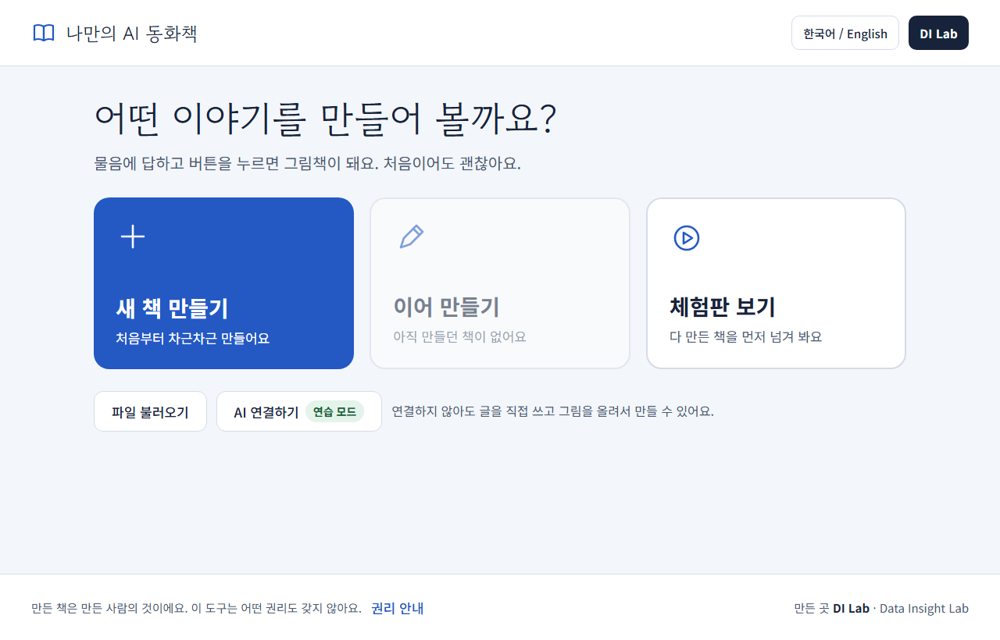
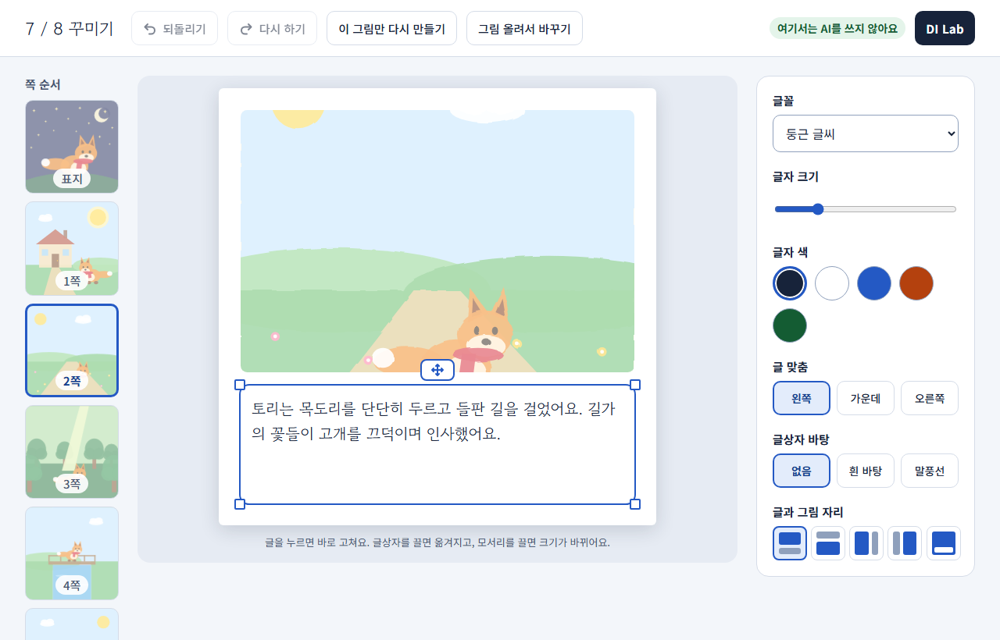
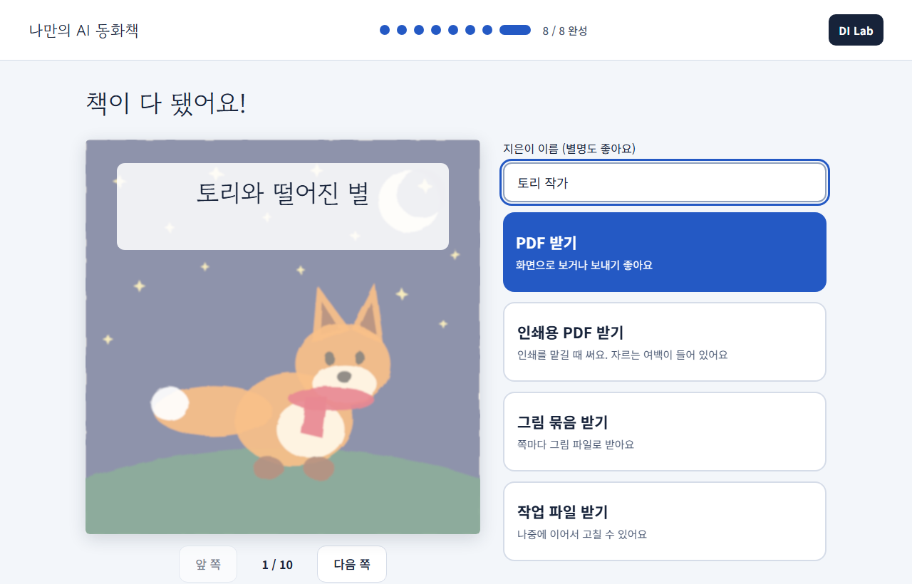
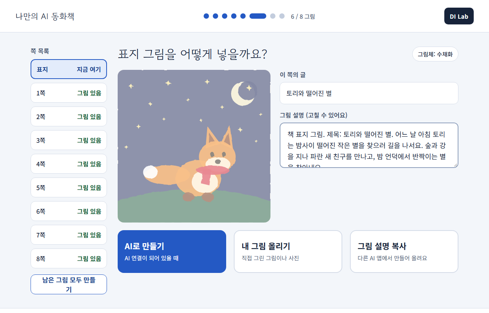
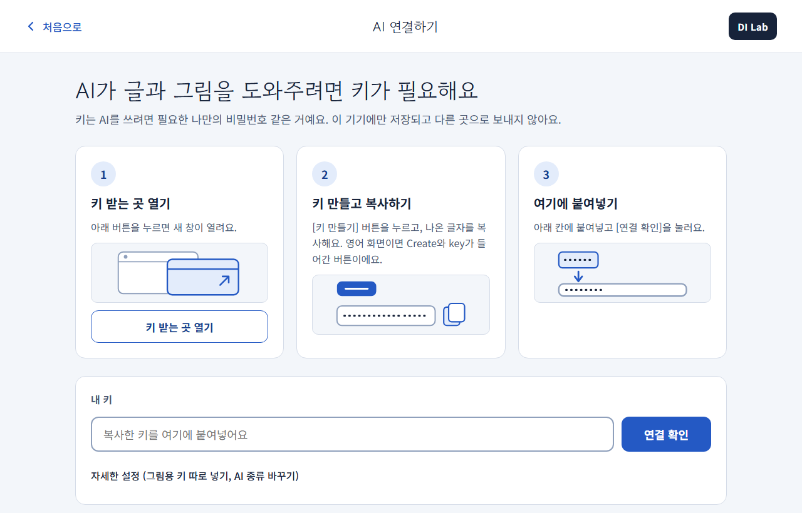

# 나만의 AI 동화책

[English](README.en.md) | **한국어**

브라우저만 열면 짧은 그림책을 만들 수 있는 도구예요. 설치도, 회원가입도 없어요.

| 시작 | 꾸미기 | 완성 |
|---|---|---|
|  |  |  |

## 바로 써보기

https://di-lab.io/my-ai-storybook/

처음이라면 시작 화면에서 [체험판 보기]를 눌러 다 만든 책을 먼저 넘겨 보세요.

## 3단계로 만들어요

1. **이야기를 정해요.** 읽을 사람, 주제, 주인공 이름과 모습, 쪽수를 고르고 줄거리를 정해요.
2. **그림을 넣어요.** 그림체를 고르고, 쪽마다 그림을 넣어요.
3. **꾸미고 받아요.** 글과 글상자를 고치고, PDF나 그림 묶음으로 받아요.

화면 위쪽에 8단계가 점으로 보여요. 언제든 앞 단계로 돌아갈 수 있어요. 만드는 동안 자동으로 저장돼요.



## 키 없이도 되는 것

AI를 연결하지 않아도 책을 끝까지 만들 수 있어요.

- **직접 쓰기.** 줄거리와 쪽마다 글을 내가 써요.
- **내 그림 올리기.** 직접 그린 그림이나 사진을 올려요.
- **그림 설명 복사.** 쪽마다 그림 설명을 복사해서 다른 AI 앱에 붙여넣고, 받은 그림을 올려요.
- **체험판 보기.** 다 만든 책을 넘겨 봐요.

AI를 연결하고 싶다면 [키 받는 법](docs/key-guide.ko.md)을 읽어 보세요.

- Google Gemini, Claude, OpenAI 중 하나의 키를 쓸 수 있어요. 키 앞머리를 보고 어느 회사 키인지 알아서 알아봐요.
- 잘 모르겠으면 Google Gemini로 시작하세요.
- Claude는 글만 만들어요. 그림은 만들지 않아요. Claude 키만 있으면 그림은 직접 올리거나, [자세한 설정]에서 그림용 키(Gemini나 OpenAI)를 따로 넣어요.



## 권리 안내

만든 책의 권리는 만든 사람에게 있습니다. 이 도구와 DI Lab은 결과물에 어떤 권리도 주장하지 않습니다.

The rights to the book you make belong to you. This tool and DI Lab claim no rights to anything you create.

글꼴, AI 그림 표시, 다른 사람의 그림을 쓸 때 주의할 점은 [권리 안내](docs/rights.ko.md)에 있어요.

## 비용 안내

가격은 2026-11-14에 각 회사의 공식 문서에서 확인했어요. 자세한 기록은 [PROVIDER_NOTES](docs/PROVIDER_NOTES.md)에 있어요. 토큰은 AI가 글을 세는 단위예요. 가격은 100만 토큰당이에요.

| 회사 | 글 (기본 AI 종류) | 그림 | 무료 한도 |
|---|---|---|---|
| Google Gemini | `gemini-3.5-flash-lite`: 입력 $0.30, 출력 $2.50 | 한 장 $0.0336 | 글에만 있어요. 그림에는 없어요. |
| Claude | `claude-haiku-5-5`: 입력 $0.10, 출력 $0.50 (`claude-sonnet-5-5` $2 / $10, `claude-opus-5-5` $4 / $20) | 만들지 않아요 | 없어요. 돈을 내는 키가 필요해요. |
| OpenAI | `gpt-6-luna`: 입력 $0.10, 출력 $0.50 (`gpt-6.1-terra` $1 / $5, `gpt-6.1-sol` $2 / $10) | 그림 출력 100만 토큰당 $30. 한 장 값은 문서에 없어요. | 문서에 없어요. |

Google Gemini로 만들 때의 책 한 권 비용이에요.

- 그림 9장(표지 1장 + 본문 8장) x $0.0336 = $0.3024
- 책 한 권에 약 0.31달러예요. 글을 쓰는 비용을 더한 값이에요.
- 그림을 다시 만들면 한 장에 $0.0336씩 더 들어요.
- 글만 AI로 쓰고 그림은 직접 올리면, 무료 한도 안에서 0원이에요.
- 그림을 만드는 Gemini AI에는 무료 한도가 없어요. 결제를 연결한 키가 있어야 해요.
- 무료 한도의 횟수는 Google AI Studio에서 확인하세요.

Claude는 글만 만들어서 책 한 권의 글 값이 약 0.002달러예요. 그림 값은 따로 들어요. 직접 올리면 0원이에요. OpenAI는 그림 한 장 값이 문서에 없어서 책 한 권의 값을 계산하지 못했어요.

가격은 바뀔 수 있어요. 가격 확인일: 2026-11-14

## 나이 조건

회사마다 나이 조건이 달라요. (2026-11-14에 확인)

- Google Gemini: 키는 만 18세 이상만 받을 수 있어요. 약관에 따라 18세 미만이 쓰는 곳에는 연결할 수 없어요. 학생이 쓰는 기기와 수업에서는 Gemini 연결을 켜 둘 수 없어요.
- Claude: 18세 미만이 쓰게 하려면 키를 받은 어른이나 기관이 Anthropic이 정한 보호 조치(나이 확인, 내용 거르기, 지켜보고 신고하는 장치 등)를 갖춰야 해요. 키를 받는 사람의 나이 조건은 약관 원문으로 확인하지 못했어요.
- OpenAI: 18세 미만에게 쓰게 하려면 키를 받은 조직이 OpenAI가 정한 보호 조치를 갖춰야 해요. 서비스 약관의 나이 조항은 확인하지 못했어요.

이 도구는 나이 확인 장치와 지켜보고 신고하는 장치를 갖추지 못했어요. 학생이 쓰는 수업에서는 AI 연결 없이 쓰는 것이 기본이에요. AI 연결 없이도 책을 끝까지 만들 수 있어요. 원문과 자세한 조건은 [선생님 안내서](docs/teacher-guide.ko.md)에 있어요.

## 자주 묻는 질문

**설치해야 하나요?**
아니요. 브라우저에서 주소를 열면 바로 써요.

**돈이 드나요?**
AI 없이 쓰면 0원이에요. Google Gemini로 글만 쓰면 무료 한도 안에서 0원이에요. 그림을 AI로 만들 때는 돈이 들어요. Claude와 OpenAI는 돈을 내는 키가 필요해요. 위의 비용 안내를 보세요.

**내 글과 그림은 어디에 저장되나요?**
만들던 책은 이 기기의 브라우저 안에 저장돼요. 서버가 없어서 우리가 볼 수 없어요. AI를 쓸 때만, 브라우저에서 내가 키를 넣은 회사(Google, Anthropic, OpenAI)로 바로 요청이 가요. 오래 두고 싶다면 [작업 파일 받기]로 파일을 받아 두세요.

**키는 안전한가요?**
키는 이 기기의 브라우저에만 저장되고 다른 곳으로 보내지 않아요. 그래도 같은 기기를 쓰는 사람은 볼 수 있어요. 함께 쓰는 기기에서는 끝나고 [이 기기에서 키 지우기]를 눌러요.

**만든 책을 팔거나 인쇄해도 되나요?**
이 도구와 DI Lab은 권리를 주장하지 않아요. 책에 쓰는 글꼴 세 가지도 인쇄하고 나눠 주고 팔아도 돼요. 다만 AI가 만든 그림을 법이 어떻게 보는지는 나라마다 달라요. 다른 사람의 그림이나 캐릭터를 올릴 때는 그 사람의 허락이 필요해요. 자세한 내용은 [권리 안내](docs/rights.ko.md)를 보세요.

**그림 속 주인공이 쪽마다 달라 보여요.**
AI는 같은 주인공도 조금씩 다르게 그려요. 이 도구는 주인공의 모습을 적은 글을 모든 그림 설명 앞에 붙여요. 마음에 안 드는 그림은 꾸미기 단계에서 [이 그림만 다시 만들기]를 눌러 다시 만들 수 있어요. 주인공 모습을 더 자세히 쓰면 더 비슷해져요.

**휴대폰에서도 되나요?**
네. 태블릿과 휴대폰 화면 크기에서 쓸 수 있게 검사하고 있어요. 글상자를 옮기고 크기를 바꾸는 일은 큰 화면이 더 편해요.

## 문서 목록

- [키 받는 법](docs/key-guide.ko.md) ([English](docs/key-guide.en.md))
- [선생님 안내서](docs/teacher-guide.ko.md) ([English](docs/teacher-guide.en.md))
- [권리 안내](docs/rights.ko.md) ([English](docs/rights.en.md))
- [AI 제공사 조건 확인 기록](docs/PROVIDER_NOTES.md)
- [개발 문서](docs/DEVELOPMENT.ko.md)
- [기여 안내](CONTRIBUTING.md)
- [제3자 고지](THIRD_PARTY_NOTICES.md)

## 개발자용

Node 20 이상이 필요해요.

```
npm install
npm run dev
```

검사 명령은 `npm run lint`, `npm run typecheck`, `npm run test`, `npm run e2e`, `npm run build`, `npm run check:secrets`, `npm run check:i18n`이에요. 자세한 내용은 [개발 문서](docs/DEVELOPMENT.ko.md)를 보세요.

실제 키로 확인하는 검사(`e2e/real-api.spec.ts`)는 `GEMINI_API_KEY`, `ANTHROPIC_API_KEY`, `OPENAI_API_KEY`가 있을 때만 돌아요.

키 없이 AI 단계를 연습하려면 주소 끝에 `?mock=1`을 붙여요. 미리 준비된 예시 이야기와 그림이 나와요.

## 라이선스

MIT 라이선스예요. [LICENSE](LICENSE)를 보세요. 글꼴과 라이브러리의 라이선스는 [THIRD_PARTY_NOTICES.md](THIRD_PARTY_NOTICES.md)에 있어요.

저장소: https://github.com/yhkim-data/my-ai-storybook

---

만든 곳 DI Lab · Data Insight Lab
