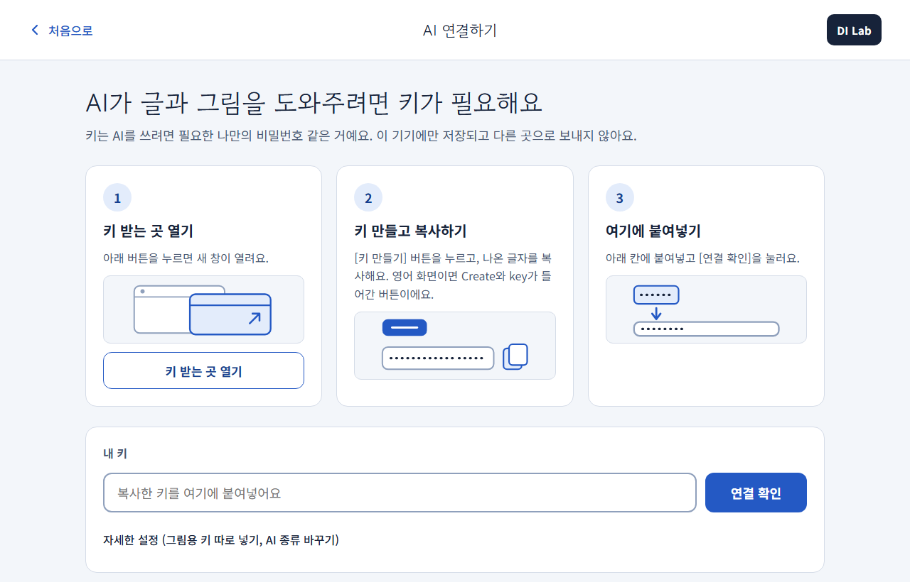

# How to get a key

**English** | [한국어](key-guide.ko.md)

A key is like your own password for using AI. You can finish a book without one.

## Who can get a key?

Only people 18 or older. This is a condition in Google's terms. (Checked: 2026-11-14)

- The terms say: "You must be 18 years of age or older to use the APIs."
- A student getting their own key does not fit the terms.
- The terms also do not allow connecting the AI to a service that people under 18 are likely to use.
- So on devices that students use, we recommend not connecting AI. See the [teacher guide](teacher-guide.en.md).

## Steps to get a key

On the start screen of the app, press [Connect AI]. The same steps are shown there.

1. **Open the key page.** Press [Open the key page] and a new window opens. To open it yourself, go to https://aistudio.google.com/apikey. You need to sign in with a Google account.
2. **Make a key and copy it.** Press the button that says Create and key. Copy the long text that appears.
3. **Paste it into the app.** Paste it in the [My key] box on the [Connect AI] screen and press [Check connection].

If you see "Connected. Key ends with ····" and the last 4 characters, it worked. The screen shows only the last 4 characters.

[Check connection] only checks that the key exists. So even when it says "Connected", pictures may fail if billing is not connected.

## What is free and what costs money

Prices were checked in Google's official documents on 2026-11-14. The full record is in [PROVIDER_NOTES](PROVIDER_NOTES.md), which is written in Korean.

| What you do | Free limit | When it costs money |
|---|---|---|
| Plot ideas and page text (writing) | Yes. Check Google AI Studio for the number of uses. | When you go over the free limit |
| Making pictures | None | $0.0336 per picture |
| Add my picture | No AI used | Free |
| Copy picture note | No AI used | Free (the other AI app has its own terms) |

- 9 pictures (1 cover and 8 pages) cost $0.3024. One book costs about 0.31 US dollars.
- The daily limit resets at midnight Pacific time.
- When you use the free limit, what you type is used by Google to improve its services, and people may read it. Do not write real names, addresses, or phone numbers.

## A separate key for pictures

You can use the same key for words and pictures. If you enter only one key, it is used for both.

If you have another key just for pictures, do this.

1. On the [Connect AI] screen, open [More settings (separate key for pictures, change the kind of AI)].
2. Paste it in the [Key for pictures] box. If you leave it empty, the key above is used too.
3. Press [Check picture key].

The boxes for changing the kind of AI are in the same place. Not sure? Leave them as they are. To go back to the first values, press [Back to the first values].

## Why you must not show your key to others

- Anyone who knows your key can use AI on your account.
- Pictures cost money, so you may have to pay when someone else uses your key.
- Do not post your key in messages, email, online boards, or screenshots.
- If someone else learns your key, delete that key at https://aistudio.google.com/apikey and make a new one.

This tool saves the key only in the browser on this device (localStorage). It sends the key only to Google.

## On a shared device

On a shared device such as a school computer, press [Erase the key from this device] on the [Connect AI] screen when you finish. When you see "The key was erased from this device.", it is done.

## When it does not work

These are the messages you may see on the screen, and what to do.

| Message on screen | What to do |
|---|---|
| "That key doesn't match. Shall we copy it again?" | Copy the key again from the first character to the last. Check that no spaces came along. If it still fails, make a new key. |
| "You've used all of today's turns. You can use it again from {time}." | The daily limit is used up. Try again after the time shown on the screen. Meanwhile you can write the words yourself and add your own pictures. |
| "Let's try again in a little while. Press [Try again] after {seconds} seconds." | Too many requests came in a short time. Press [Try again] after the seconds shown. |
| "This key can't make that. Pictures need a key that is paid for. You can press [Add my picture] instead." | The AI that draws pictures needs a key with billing connected. Connect billing, or press [Add my picture] and add your own. |
| "We can't make it with these words. Shall we try different words?" | The AI did not make it for safety reasons. Change the picture note or the story words and try again. |

{time} and {seconds} are replaced by the real time and seconds on the screen.

Other things to try.

- If you see "The internet seems to be off.", check your connection and press [Check connection] or [Try again] again.
- If you see "We can't check right now.", press [Check connection] again in a little while.
- To practice without a key, add `?mock=1` to the end of the app address. You get ready-made stories and pictures.
