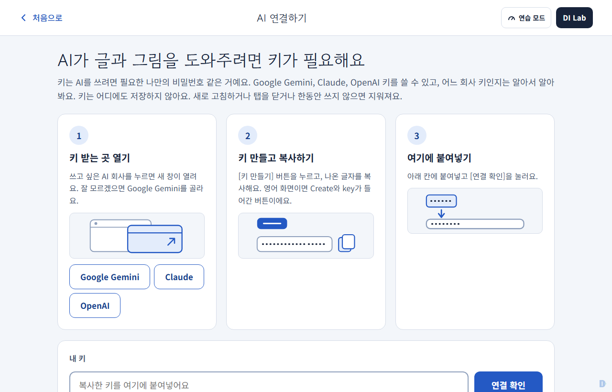

# 키 발급 방법

[English](key-guide.en.md) | **한국어**

키(API 키)는 AI 회사의 서비스를 쓰기 위한 개인 인증 문자열입니다. 키가 없어도 책은 끝까지 만들 수 있습니다.

## 어느 회사의 키를 쓸지

세 회사의 키를 쓸 수 있습니다. 앱은 키의 앞부분을 보고 어느 회사의 키인지 자동으로 알아봅니다.

| 회사 | 글 | 그림 | 책 한 권 대략 비용 | 키 발급처 |
|---|---|---|---|---|
| AI 연결 없음 | 직접 작성 | 직접 업로드 | 무료 | 필요 없음 |
| Google Gemini (무료 한도) | 가능 | 불가 | 무료 (Google이 정한 이용 한도 내) | <https://aistudio.google.com/apikey> |
| Google Gemini (결제 연결) | 가능 | 가능 | 약 0.31달러 (그림 9장 포함) | <https://aistudio.google.com/apikey> |
| Claude | 가능 | 불가 | 글 약 0.002달러 (그림 별도) | <https://platform.claude.com/settings/keys> |
| OpenAI | 가능 | 가능 | 산정 불가 (공식 문서에 그림 1장 가격 없음) | <https://platform.openai.com/api-keys> |

- 무료 한도는 결제를 연결하지 않은 Google AI Studio 키에 적용되며, 이용 횟수는 Google이 정합니다.
- 무료 한도로 쓰면 입력한 내용과 AI의 응답이 Google의 제품 개선에 쓰일 수 있고, 사람이 검토할 수 있습니다(Gemini API 약관, 2026-11-14 확인). 진짜 이름, 주소, 전화번호 같은 개인정보는 입력하지 마십시오.
- 학생 수업에는 Gemini를 쓸 수 없습니다. 아래 [누가 키를 받을 수 있는지](#누가-키를-받을-수-있는지)와 [선생님 안내서](teacher-guide.ko.md)를 확인하십시오.
- 키가 없으면 AI 기능은 동작하지 않으며, 도구 운영자의 키나 비용이 쓰이지 않습니다.

개인이 처음 사용할 때는 Gemini 무료 한도로 글을 만들어 보는 것이 가장 간단합니다. 학생 수업에 쓰려면 [선생님 안내서](teacher-guide.ko.md)의 유의사항을 먼저 확인하십시오.

- Claude는 글만 만듭니다. Claude 키만 있다면 그림은 직접 올리거나, [자세한 설정]에서 그림용 키(Gemini 또는 OpenAI)를 따로 넣습니다.
- Claude 키를 [그림용 키] 칸에 넣으면 "Claude 키로는 그림을 만들 수 없어요"라는 안내가 나옵니다.

## 누가 키를 받을 수 있는지

회사마다 나이 조건이 다릅니다. (2026-11-14 확인)

- **Google Gemini:** 만 18세 이상만 키를 받을 수 있습니다.
  - 약관 원문: "You must be 18 years of age or older to use the APIs."
  - 학생(18세 미만)은 키를 받을 수 없습니다.
  - 약관은 18세 미만이 쓰는 서비스에 연결하는 것도 금지합니다. 따라서 학생이 쓰는 기기와 수업에서는 Gemini 연결을 켜 둘 수 없습니다.
- **Claude (Anthropic):** 금지가 아니라 조건부입니다. 18세 미만이 쓰게 하려면 키를 받은 성인이나 기관이 나이 확인, 내용 필터링, 모니터링과 신고 장치, 안전한 사용 안내를 갖춰야 합니다. 키와 콘솔에 적용되는 Anthropic 상업 서비스 약관(Commercial Terms of Service)에는 키를 받는 사람의 나이 조항이 없습니다(2026-11-14 확인). 18세 이상 조건은 Claude.ai 같은 개인용 서비스 약관(Consumer Terms, 2025-10-08 시행)에 있습니다.
- **OpenAI:** 금지가 아니라 조건부입니다. 18세 미만이 쓰게 하려면 키를 받은 조직이 보호 조치를 갖추고, 부모나 법정대리인의 동의를 받아야 합니다(서비스 계약 한국어판, 2026-11-14 확인).
- 이 도구에는 나이 확인 장치와 모니터링·신고 장치가 없습니다. 따라서 학생이 쓰는 수업에서는 AI 연결 없이 쓰는 것을 기본으로 합니다.
- 원문과 판단 기준은 [선생님 안내서](teacher-guide.ko.md)에 있습니다.

## 키 발급 순서

앱의 시작 화면에서 [AI 연결하기]를 누르면 같은 순서가 화면에 나옵니다.

1. **키 발급처를 엽니다.** 쓰려는 회사(Google Gemini, Claude, OpenAI)의 단추를 누르면 새 창이 열립니다. 위 표의 주소로 직접 가도 됩니다. 그 회사 계정으로 로그인해야 합니다.
2. **키를 만들고 복사합니다.** "Create"와 "key"가 들어간 키 만들기 단추를 누르고, 표시된 긴 문자열을 복사합니다.
3. **앱에 붙여넣습니다.** [AI 연결하기] 화면의 [내 키] 칸에 붙여넣고 [연결 확인]을 누릅니다.

"{회사 이름}에 연결됐어요. 키 끝자리 ····"와 끝 4자리가 보이면 연결된 것입니다. 화면에는 키의 끝 4자리만 표시됩니다.

[연결 확인]은 키가 유효한지만 확인하며, 실제로 글이나 그림을 만들지는 않습니다. 따라서 연결이 확인되어도 결제 설정이 없으면 글이나 그림이 만들어지지 않을 수 있습니다.

## 비용

가격은 2026-11-14에 각 회사의 공식 문서에서 확인했습니다. 자세한 기록은 [PROVIDER_NOTES](PROVIDER_NOTES.md)에 있습니다. 가격은 모두 100만 토큰당 가격이며, 토큰은 AI가 글의 양을 세는 단위입니다.

| 회사 | 기본 글 AI | 글 가격 (입력 / 출력) | 그림 | 무료 한도 |
|---|---|---|---|---|
| Google Gemini | `gemini-3.5-flash-lite` | $0.30 / $2.50 | 1장 $0.0336 | 글에만 있습니다. 횟수는 Google AI Studio에서 확인합니다. |
| Claude | `claude-haiku-5-5` | $0.10 / $0.50 | 지원하지 않음 | 없음 |
| OpenAI | `gpt-6-luna` | $0.10 / $0.50 | 그림 출력 100만 토큰당 $30 (1장 가격은 문서에 없음) | 문서에 없음 |

선택할 수 있는 다른 글 AI도 있습니다.

- Claude: `claude-sonnet-5-5` ($2 / $10), `claude-opus-5-5` ($4 / $20)
- OpenAI: `gpt-6.1-terra` ($1 / $5), `gpt-6.1-sol` ($2 / $10)

| 작업 | 비용이 드는 경우 |
|---|---|
| 줄거리 제안, 쪽 나누기 (글) | Gemini는 무료 한도를 넘을 때. Claude와 OpenAI는 쓸 때마다 |
| 그림 만들기 | Gemini는 1장에 $0.0336. OpenAI는 위 표 참조. Claude는 그림을 만들지 않습니다. |
| 내 그림 올리기 | 무료 (AI를 쓰지 않습니다) |
| 그림 설명 복사 | 무료 (다른 AI 서비스의 조건은 그 서비스를 따릅니다) |

- Gemini로 그림 9장(표지 1장, 본문 8장)을 만들면 $0.3024입니다. 책 한 권에 약 0.31달러입니다.
- Claude는 글만 만들며, 책 한 권의 글 비용은 약 0.002달러입니다(기본 AI, 글 요청 2회, 입력 약 2천 토큰과 출력 약 4천 토큰 기준). 그림 비용은 별도이며, 직접 올리면 들지 않습니다.
- OpenAI는 그림 1장 가격이 문서에 없어 책 한 권의 비용을 산정하지 못했습니다.
- Gemini의 하루 한도는 미국 태평양 시간 자정에 초기화됩니다.
- Anthropic 상업 서비스 약관에는 "Anthropic may not train models on Customer Content from Services."라는 조항이 있습니다(2026-11-16 확인). OpenAI가 입력 내용을 어떻게 쓰는지는 확인하지 않았습니다. 어느 회사를 쓰든 진짜 이름, 주소, 전화번호는 입력하지 마십시오.

## 그림용 키 따로 넣기

글과 그림에 같은 키를 쓸 수 있습니다. 키를 하나만 넣으면 글과 그림에 모두 쓰입니다. 그림을 만들 수 없는 Claude 키를 쓴다면 그림용 키를 따로 넣습니다.

그림용 키를 따로 넣는 경우는 다음과 같습니다.

- Claude 키로 글을 쓰고, 그림은 Gemini나 OpenAI로 만들려는 경우
- 그림에만 쓸 다른 키가 있는 경우

넣는 방법은 다음과 같습니다.

1. [AI 연결하기] 화면에서 [자세한 설정 (그림용 키 따로 넣기, AI 종류 바꾸기)]를 엽니다.
2. [그림용 키] 칸에 Gemini 또는 OpenAI 키를 붙여넣습니다. 비워 두면 위의 키를 함께 씁니다.
3. [그림용 키 연결 확인]을 누릅니다.

AI 종류를 바꾸는 칸도 같은 곳에 있습니다. 선택할 수 있는 종류는 글 키의 회사에 따라 바뀝니다. 잘 모르면 그대로 두십시오. 처음 값으로 돌리려면 [처음 값으로 되돌리기]를 누릅니다.

## 키를 다른 사람에게 보여 주면 안 되는 이유

- 키를 아는 사람은 내 계정으로 AI를 쓸 수 있습니다.
- 결제가 연결된 키를 다른 사람이 쓰면 그 비용을 내가 내야 할 수 있습니다.
- 키를 메시지, 메일, 인터넷 게시판, 화면 사진에 올리지 마십시오.
- 키가 다른 사람에게 알려졌다면 키 발급처(위 표의 주소)에서 그 키를 삭제하고 새로 만드십시오.

이 도구는 키를 이 기기의 브라우저(localStorage)에만 저장합니다. AI를 쓸 때만 그 키를 발급한 회사(Google, Anthropic, OpenAI)로 보내며, 다른 곳으로는 보내지 않습니다.

## 함께 쓰는 기기

학교 컴퓨터처럼 여러 사람이 함께 쓰는 기기에서는 사용을 마친 뒤 [AI 연결하기] 화면에서 [이 기기에서 키 지우기]를 누르십시오. "이 기기에서 키를 지웠어요."라는 안내가 나오면 완료된 것입니다.

## 문제 해결

화면에 나오는 안내 문구와 해결 방법입니다.

| 화면 문구 | 해결 방법 |
|---|---|
| "키가 맞지 않아요. 다시 복사해 볼까요?" | 키를 처음부터 끝까지 다시 복사합니다. 앞뒤에 공백이 들어가지 않았는지 확인합니다. 그래도 안 되면 새 키를 만듭니다. |
| "오늘 쓸 수 있는 횟수를 다 썼어요. {time}부터 다시 쓸 수 있어요." | 하루 한도를 모두 쓴 상태입니다. 화면에 나온 시각 이후에 다시 시도합니다. 그동안 글을 직접 쓰고 그림을 올릴 수 있습니다. |
| "조금 뒤에 다시 해 볼게요. {seconds}초 뒤에 [다시 하기]를 눌러요." | 짧은 시간에 요청이 너무 많았습니다. 표시된 시간이 지난 뒤 [다시 하기]를 누릅니다. |
| "이 키로는 만들 수 없어요. 그림은 돈을 내는 키가 필요해요. [내 그림 올리기]를 눌러도 돼요." | 결제가 연결되지 않은 키입니다. Gemini의 그림, Claude, OpenAI는 결제가 연결된 키가 필요합니다. 결제를 연결하거나 [내 그림 올리기]로 직접 올립니다. |
| "이 내용으로는 만들 수 없어요. 다른 말로 바꿔 볼까요?" | AI가 안전 기준에 따라 만들지 않았습니다. 그림 설명이나 이야기를 다른 표현으로 바꿔 다시 시도합니다. |
| "키는 맞는 것 같지만, 이 키를 만든 Claude 조직의 설정에서 브라우저 사용이 꺼져 있어요. 조직을 관리하는 사람에게 켜 달라고 하거나 다른 키를 넣어 주세요." | Claude 조직 설정에서 브라우저의 직접 호출을 막은 상태입니다. 키가 틀린 것은 아닙니다. 조직 관리자에게 설정 변경을 요청하거나 다른 키를 넣습니다. |

{time}과 {seconds} 자리에는 실제 시각과 초가 표시됩니다.

만드는 도중에 같은 상황이 생기면 "이 키를 만든 Claude 조직의 설정에서 브라우저 사용이 꺼져 있어요. 조직을 관리하는 사람에게 켜 달라고 하거나 [AI 연결하기]에서 다른 키를 넣어 주세요."라는 안내가 나옵니다. 이때 Claude는 401 상태와 "CORS requests are not allowed for this Organization"이라는 응답을 보냅니다. 이 문구가 없는 401은 "키가 맞지 않아요"로 표시됩니다.

그 밖의 경우는 다음과 같이 합니다.

- "인터넷 연결이 끊긴 것 같아요."가 나오면 연결을 확인한 뒤 [연결 확인]이나 [다시 하기]를 다시 누릅니다.
- "지금은 확인할 수 없어요."가 나오면 잠시 뒤 [연결 확인]을 다시 누릅니다.
- 키 없이 연습하려면 앱 주소 끝에 `?mock=1`을 붙입니다. 미리 준비된 예시 이야기와 그림이 나옵니다.
